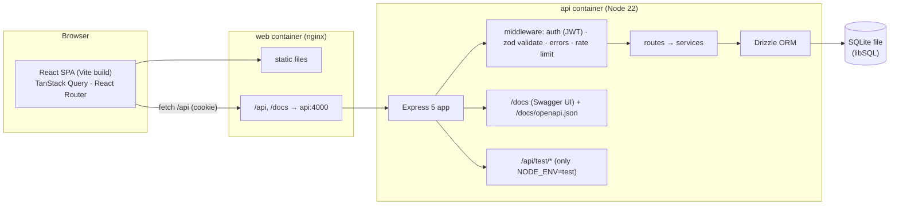

# TaskFlow — PLAN.md

> Handoff document for `taskflow-web-app`. **Every model reads this first** and follows it instead of re-deriving the design.
> Source spec: `../fable-portfolio-spec.md`, section 1 (plus ground rules in section 0).
> When you finish a task in section 11: tick its box and add a one-line note. If a task needs a design decision that is not in this file, **stop and ask** — do not improvise.

---

## 1. Goals

TaskFlow is a small, polished task and project tracker for small teams. It has two jobs:

1. **Be a convincing product.** Clients open the live demo first. It must look like something a startup would sell.
2. **Be an excellent system under test.** Repo 2 (`playwright-jenkins-e2e`) automates it, so it needs stable test ids, deterministic seed data, isolated test workspaces and predictable API errors.

It is a **personal portfolio project** and the README says so. No fake clients, testimonials or results.

Non-goals: real email sending, real-time sync (websockets), file uploads, billing, multi-tenant organisations, i18n.

---

## 2. Architecture



### Key decisions (do not change without asking)

| Area | Decision | Why |
|---|---|---|
| Monorepo | npm workspaces: `api`, `web`. Root holds scripts, Docker, CI. | Spec. npm is already installed; no pnpm. |
| Node | **22 LTS** in Docker, CI and `.nvmrc`. `engines: >=22`. Must also work on the dev machine's Node 26. | LTS for reproducibility. |
| API framework | Express 5 + TypeScript (ESM, `tsx` in dev, `tsc` build). | Most widely recognised by clients. |
| DB | SQLite through **Drizzle ORM + `@libsql/client`** (`file:` URL; `:memory:` in tests). Migrations generated by `drizzle-kit`, applied on startup. | libSQL ships N-API prebuilds, so no native compile on Windows / Node 26 (unlike `better-sqlite3`). If it fails to install on Node 26, stop and report. |
| Validation | Zod on every body, query and params. | Spec. |
| OpenAPI | `@asteasolutions/zod-to-openapi` builds the spec from the same Zod schemas. Swagger UI at `/docs`, JSON at `/docs/openapi.json`. | One source of truth. |
| Auth | JWT (HS256, 7 days) in an **httpOnly cookie** `tf_token` (`SameSite=Lax`). The API **also accepts `Authorization: Bearer`**; login/signup return the token in the body. | Cookie for the browser, Bearer for API tests in repo 2. |
| Passwords | `bcryptjs`, cost 10 (cost 4 when `NODE_ENV=test`). | Pure JS, no native build. |
| Same origin | The browser always talks to `/api` on its own origin: Vite dev proxy locally, nginx proxy in compose, Express serving the web build in the single-image deploy. | No CORS or third-party-cookie problems. |
| Web | React 19, Vite, TypeScript strict, **Tailwind v4** (tokens in CSS `@theme` + CSS variables), shadcn/ui + Radix, lucide-react. | Spec. |
| Web data | TanStack Query for server state, React Router 7 (library mode), react-hook-form + Zod for forms. API types generated with `openapi-typescript` from `/docs/openapi.json` into `web/src/api/schema.d.ts`. | Contract stays in sync with the API. |
| Web libs | `@dnd-kit/core` + `sortable`, `motion` (Framer Motion), Recharts, `cmdk`, `sonner` (toasts), `date-fns`, `react-markdown` + `rehype-sanitize`. | Spec. |
| Rich description | **Markdown** with Write / Preview tabs (sanitised render). No WYSIWYG editor. | Looks rich, stays testable and light. |
| Font | Inter Variable, self-hosted via `@fontsource-variable/inter`. | No external font CDN. |
| Deploy | One Docker image (`Dockerfile` at root): API serves the web build when `SERVE_WEB_DIR` is set. Target: Render free web service via `render.yaml`. Needs the owner's account → `DEPLOY.md`. | One free service, one origin. |
| Demo data on the live host | Free hosts have ephemeral disks, so the DB is reseeded on boot when empty and every `DEMO_RESET_INTERVAL_MINUTES`. README says the demo resets. | Honest and self-healing. |

---

## 3. Folder structure

```
taskflow-web-app/
├─ PLAN.md  README.md  DEPLOY.md  LICENSE  .env.example
├─ package.json            # workspaces + root scripts (dev, lint, typecheck, test, build, screenshots)
├─ docker-compose.yml      # api + web, one command
├─ docker-compose.test.yml # override: NODE_ENV=test (used by repo 2)
├─ Dockerfile              # single-image deploy (api serves web)
├─ render.yaml
├─ .github/workflows/ci.yml
├─ .gitleaks.toml
├─ docs/                   # screenshots/, TEST_IDS.md, architecture notes
├─ scripts/screenshots.ts  # Playwright script: every page × light/dark × desktop/mobile
├─ api/
│  ├─ Dockerfile  package.json  tsconfig.json  vitest.config.ts  drizzle.config.ts
│  ├─ drizzle/                    # generated SQL migrations
│  └─ src/
│     ├─ index.ts                 # reads env, starts server
│     ├─ app.ts                   # createApp({ db, env }) — no listen(), used by tests
│     ├─ env.ts                   # Zod-parsed environment
│     ├─ db/        schema.ts  client.ts  migrate.ts  seed.ts  seed-data.ts
│     ├─ middleware/ auth.ts  requireRole.ts  validate.ts  error.ts  rateLimit.ts
│     ├─ lib/       errors.ts  jwt.ts  password.ts  dates.ts  position.ts  ids.ts
│     ├─ schemas/   *.schema.ts   # Zod, registered with OpenAPI
│     ├─ services/  auth  users  projects  members  tasks  comments  dashboard  search  permissions
│     ├─ routes/    auth  users  projects  tasks  comments  dashboard  search  health  test  docs
│     └─ openapi.ts
│  └─ tests/  unit/  integration/  helpers/
└─ web/
   ├─ Dockerfile  nginx.conf  package.json  vite.config.ts  index.html
   ├─ public/      favicon.svg  landing/*.png
   └─ src/
      ├─ main.tsx  App.tsx  router.tsx
      ├─ styles/   tokens.css  globals.css
      ├─ api/      client.ts  schema.d.ts  queries/*.ts   # one file per resource
      ├─ lib/      testids.ts  dates.ts  shortcuts.ts  cn.ts
      ├─ components/
      │  ├─ ui/        # shadcn primitives, themed
      │  ├─ brand/     Logo.tsx  Wordmark.tsx
      │  ├─ layout/    AppShell  Sidebar  TopBar  BottomNav  CommandPalette  ShortcutsDialog
      │  ├─ tasks/     TaskCard  TaskPanel  TaskForm  PriorityBadge  StatusBadge  DueDate  LabelChip
      │  ├─ board/     Board  BoardColumn  SortableTaskCard
      │  ├─ list/      TaskTable  TaskFilters
      │  ├─ dashboard/ StatCard  StatusChart  CompletedChart  OverdueList
      │  └─ common/    Avatar  EmptyState  Skeletons  ErrorState  illustrations/
      ├─ pages/    Landing  Login  Signup  Dashboard  MyTasks  ProjectBoard  ProjectList
      │            ProjectSettings  Settings  NotFound
      ├─ hooks/    useAuth  useTheme  useShortcuts  useMediaQuery
      └─ test/     setup.ts  msw/  *.test.tsx next to components
```

---

## 4. Data model

IDs are 12-char nanoid strings. Timestamps are ISO strings (UTC). `dueDate` is a date-only string `YYYY-MM-DD`.

| Table | Columns |
|---|---|
| `users` | `id`, `email` (unique, lowercased), `name`, `passwordHash`, `role` (`admin` \| `member`), `avatarColor`, `isProtected` (bool; seeded demo accounts), `createdAt` |
| `projects` | `id`, `name`, `key` (2–4 uppercase letters, e.g. `WEB`), `description`, `color`, `ownerId` → users, `createdAt`, `updatedAt` |
| `project_members` | `projectId`, `userId` (composite PK), `createdAt` |
| `invites` | `id`, `projectId`, `email`, `invitedById`, `createdAt`; unique (`projectId`, `email`) |
| `tasks` | `id`, `projectId`, `number` (per-project counter → shown as `WEB-12`), `title`, `description` (markdown), `status` (`todo` \| `in_progress` \| `done`), `priority` (`low` \| `medium` \| `high` \| `urgent`), `dueDate` (nullable), `assigneeId` (nullable), `position` (real), `createdById`, `createdAt`, `updatedAt`, `completedAt` (nullable) |
| `labels` | `id`, `projectId`, `name`, `color` |
| `task_labels` | `taskId`, `labelId` (composite PK) |
| `comments` | `id`, `taskId`, `authorId`, `body`, `createdAt` |
| `activity` | `id`, `taskId`, `actorId`, `type` (`created` \| `status_changed` \| `priority_changed` \| `assigned` \| `due_changed` \| `renamed` \| `commented`), `data` (JSON: `from`, `to`), `createdAt` |

All foreign keys cascade on delete, except `tasks.assigneeId` which is set to null.

### Business rules

- **Roles are global.** `admin` sees and manages every project and all users. `member` sees only projects they own or belong to.
- **Project owner** (the creator) can rename/delete the project and invite/remove its members. Admin can do the same on any project.
- Any project member can create, edit, move and delete tasks and comments in that project. Comments can be deleted by their author or an admin.
- **Invites are stored only.** If the invited email already has an account, the user is added as a member immediately. Otherwise an `invites` row is kept and applied automatically when that email signs up.
- **Assignee** must be a member of the task's project (else 400).
- **Ordering**: `position` is a float. Moving a card sets it to the midpoint between its new neighbours (helper in `lib/position.ts`); new tasks go to the end of their column.
- `completedAt` is set when status becomes `done` and cleared when it leaves `done`.
- **Overdue** = `dueDate < today` and `status != done`. "Today" is the **UTC date** on both server and client (shared rule, one helper each). Document this in the README.
- **Protected accounts** (`isProtected`): cannot be deleted, demoted, or have their password or email changed. This keeps the public demo usable.
- Password rule: at least 8 characters, one letter, one digit. Email is trimmed and lowercased.

---

## 5. API contract

Base path `/api`. JSON only. All routes need auth except `health`, `auth/signup`, `auth/login` and `test/*`.

### Error format (every non-2xx)

```json
{ "error": { "code": "VALIDATION_ERROR", "message": "Invalid request", "details": [{ "path": "email", "message": "Enter a valid email" }] } }
```

| Status | `code` | When |
|---|---|---|
| 400 | `VALIDATION_ERROR` | Zod failure (with `details`) or broken business rule |
| 401 | `UNAUTHENTICATED` | No/invalid/expired token; wrong email or password on login |
| 403 | `FORBIDDEN` | Authenticated but not allowed (not admin, not owner, **not a member of an existing project**) |
| 404 | `NOT_FOUND` | Resource or route does not exist |
| 409 | `CONFLICT` | Email already registered; member/invite already exists |
| 429 | `RATE_LIMITED` | Too many login attempts (10 per minute per IP; **disabled when `NODE_ENV=test`**) |

### Endpoints

| Method & path | Notes |
|---|---|
| `GET /health` | `{ status: "ok", version, uptime, db: "ok" }` |
| `POST /auth/signup` | `{ name, email, password }` → 201 `{ user, token }`, sets cookie. New users are `member`. Applies pending invites. |
| `POST /auth/login` | `{ email, password }` → 200 `{ user, token }`, sets cookie |
| `POST /auth/logout` | 204, clears cookie |
| `GET /auth/me` | current user |
| `PATCH /auth/me` | `{ name?, currentPassword?, newPassword? }` |
| `GET /users` | **admin** — all users with project counts |
| `PATCH /users/:id` | **admin** — `{ role }` |
| `DELETE /users/:id` | **admin** — 204. Cannot delete self or a protected account (400). |
| `GET /projects` | member: own + joined; admin: all. Includes task counts per status and member count. |
| `POST /projects` | `{ name, description?, color? }` → 201. `key` derived from the name, unique. |
| `GET /projects/:id` | project + members + labels |
| `PATCH /projects/:id` | owner/admin — `{ name?, description?, color? }` |
| `DELETE /projects/:id` | owner/admin — 204 |
| `GET /projects/:id/members` | members + pending invites |
| `POST /projects/:id/invites` | owner/admin — `{ email }` → 201 `{ member }` or `{ invite }` |
| `DELETE /projects/:id/invites/:inviteId` | owner/admin |
| `DELETE /projects/:id/members/:userId` | owner/admin — cannot remove the owner (400). Unassigns that user's tasks in the project. |
| `GET /projects/:id/tasks` | Query: `status`, `priority`, `assignee` (user id \| `me` \| `none`), `label`, `q` (title/description, case-insensitive), `overdue=true`, `sort` (`position` \| `dueDate` \| `priority` \| `createdAt` \| `title`), `order` (`asc` \| `desc`). Default `position asc`. Null due dates sort last. |
| `POST /projects/:id/tasks` | `{ title, description?, status?, priority?, dueDate?, assigneeId?, labelIds? }` → 201 |
| `GET /tasks` | Tasks across my projects. Same filters; used by "My tasks" with `assignee=me`. |
| `GET /tasks/:id` | task + labels + comments + activity |
| `PATCH /tasks/:id` | any task field, plus `position`. Writes activity rows. |
| `DELETE /tasks/:id` | 204 |
| `POST /tasks/:id/comments` | `{ body }` → 201 |
| `DELETE /comments/:id` | author/admin |
| `GET /projects/:id/labels` · `POST /projects/:id/labels` | list / create `{ name, color }` |
| `GET /dashboard` | `{ counts: { todo, in_progress, done, overdue }, byPriority, completedByDay (last 14 days), overdue: Task[], myTasks: Task[] }` scoped to visible projects |
| `GET /search?q=` | `{ projects: [], tasks: [] }` (max 8 each) for the command palette |
| `GET /docs` · `GET /docs/openapi.json` | Swagger UI / spec (served at root, not under `/api`) |

Task objects in lists always include: `id`, `key` (`WEB-12`), `projectId`, `title`, `status`, `priority`, `dueDate`, `position`, `assignee` (`{ id, name, avatarColor }` or null), `labels`, `commentCount`, `createdAt`, `updatedAt`.

### Test-only endpoints (`NODE_ENV=test`, otherwise the router is **not mounted** → 404)

| Endpoint | Behaviour |
|---|---|
| `POST /api/test/reset` | Wipes all tables. Body `{ seed?: "demo" \| "none" }` (default `demo`). **Global — not parallel-safe.** For serial suites and local use. |
| `POST /api/test/seed` | Body `{ scenario: "workspace" \| "demo", tasks?: number }`. `workspace` (default) creates an **isolated workspace with unique emails**: one admin, one member (project member), one outsider (not a project member), one project with labels and a fixed set of tasks covering every status, priority, an overdue task, a due-today task and an unassigned task. Returns `{ admin, member, outsider }` each as `{ id, email, password }`, plus `project` and `tasks`. **Parallel-safe**: members only see their own workspace. |

Note for repo 2: admins see *all* projects, so admin-view assertions must target the seeded project by id/name, not by total counts.

A required unit/integration test proves both endpoints return 404 when `NODE_ENV` is `production` or `development`, and work when it is `test`.

### Environment variables (`.env.example`, placeholders only)

| Var | Default | Notes |
|---|---|---|
| `NODE_ENV` | `development` | `test` enables `/api/test/*`, disables rate limiting |
| `PORT` | `4000` | API port |
| `DATABASE_URL` | `file:./data/taskflow.db` | `:memory:` in tests |
| `JWT_SECRET` | — | **Required** when `NODE_ENV=production` (startup fails without it). Dev/test use a clearly named insecure default. |
| `JWT_EXPIRES_IN` | `7d` | |
| `COOKIE_SECURE` | `false` | `true` behind HTTPS |
| `SEED_ON_START` | `true` | Seed demo data if the DB is empty |
| `DEMO_RESET_INTERVAL_MINUTES` | `0` (off) | Live demo: `60` |
| `SERVE_WEB_DIR` | unset | Single-image deploy: path to the web build |
| `WEB_PORT` | `8080` | compose: published web port |
| `API_PROXY_TARGET` | `http://localhost:4000` | Vite dev proxy target |

The demo passwords (`Demo123!`, `Member123!`) are public by design and live in seed code and the login page. Add them to the gitleaks allowlist if flagged; nothing else is ever allowlisted.

---

## 6. Seed data (demo scenario)

Invented people only. Everything must look believable.

- **Users**: `demo@taskflow.dev` / `Demo123!` — *Alex Morgan*, **admin**, protected. `member@taskflow.dev` / `Member123!` — *Sam Rivera*, **member**, protected. Plus 4 more members (e.g. Priya Shah, Jonas Weber, Mei Tanaka, Lucas Oliveira) with their own colours.
- **Projects**: *Website Redesign* (`WEB`), *Mobile App Launch* (`APP`), *Q1 Marketing Campaign* (`MKT`). Sam is a member of the first two only (so role differences are visible).
- **Tasks**: 12–16 per project, spread over all statuses and priorities, with realistic titles ("Audit current landing page copy", "Fix checkout button contrast on mobile"), markdown descriptions on about half, labels (`design`, `frontend`, `backend`, `bug`, `content`, `research`), 0–4 comments, activity history.
- **Dates are relative to the seed time**: 3–4 overdue, 2 due today, 2 due tomorrow, others within three weeks, some without a date. Completed tasks are spread over the last 14 days so the dashboard chart has a real shape.
- One pending invite on *Website Redesign*.

---

## 7. Design system

Quality bar: modern work tools (calm, dense, precise). TaskFlow has its **own** identity — do not copy another product's branding, layout or copy.

### Brand

- **Name**: TaskFlow. **Wordmark**: Inter 600, letter-spacing −0.02em, "Task" in foreground colour, "Flow" in accent.
- **Logo** (`Logo.tsx`, inline SVG, 24×24 viewBox): rounded square (radius 6) filled with the accent; inside, three white rounded bars of equal height, each one shorter and shifted further right than the one above — tasks flowing forward. Also used as `favicon.svg`.
- **Voice**: short, plain, friendly. "No tasks here yet." not "Oops! Looks like…".

### Colour tokens (CSS variables in `tokens.css`, mapped into Tailwind `@theme`)

| Token | Light | Dark | Use |
|---|---|---|---|
| `--bg` | `#F7F8FA` | `#0E1014` | app background |
| `--surface` | `#FFFFFF` | `#15181E` | cards, panels, sidebar |
| `--surface-2` | `#F1F3F6` | `#1C2028` | hover, columns, inputs |
| `--border` | `#E3E6EB` | `#272C36` | hairlines |
| `--border-strong` | `#CBD0D8` | `#3A4150` | inputs, dividers that matter |
| `--fg` | `#14171C` | `#ECEEF2` | primary text |
| `--fg-muted` | `#5B6472` | `#9AA3B2` | secondary text |
| `--fg-subtle` | `#6E7786` | `#7F8898` | placeholders, meta (still AA on its surface) |
| `--accent` | `#2F5BEA` | `#2F5BEA` | primary buttons (white text), active states — "Flow Blue" |
| `--accent-hover` | `#2449C8` | `#4369EE` | |
| `--accent-fg` | `#2F5BEA` | `#8FA5FF` | accent-coloured text, links, icons |
| `--accent-soft` | `#EAF0FF` | `#1A2444` | selected rows, soft badges |
| `--success` / `-soft` | `#15803D` / `#E7F6EC` | `#4ADE80` / `#12301F` | done |
| `--warning` / `-soft` | `#B45309` / `#FDF3E1` | `#FBBF24` / `#33260B` | due soon, high priority |
| `--danger` / `-soft` | `#DC2626` / `#FDECEC` | `#F87171` / `#3A1616` | overdue, urgent, destructive |
| `--ring` | `#2F5BEA` | `#8FA5FF` | focus ring: 2px + 2px offset, always visible on `:focus-visible` |

Rules: one accent only. Colour is never the only signal — status and priority always pair colour with an icon and a text label. Every text/background pair must pass **WCAG AA** in both themes; verify with axe during the review task, and adjust the token (not the component) if one fails.

**Status**: `todo` — neutral, `Circle` icon · `in_progress` — accent, `CircleDashed`/half icon · `done` — success, `CheckCircle2`.
**Priority**: `urgent` — danger, `AlertOctagon` · `high` — warning, `SignalHigh` · `medium` — accent-fg, `SignalMedium` · `low` — muted, `SignalLow`.
**Avatars**: initials on one of 8 fixed background colours (`avatarColor`), white text, all AA.
**Labels**: small chips, soft tinted background + coloured dot, 8 preset colours.

### Type, spacing, shape

- **Type scale** (px / line-height): 12/16 · 13/18 · **14/20 (UI base)** · 16/24 · 18/26 · 20/28 · 24/32 · 30/38 · 36/44 · 48/56 (landing hero; 36 on mobile). Weights 400, 500, 600. Headings −0.01em to −0.02em tracking.
- **Numbers**: `font-variant-numeric: tabular-nums` on the dashboard, task keys, counts and dates.
- **Spacing**: 4px base (4, 8, 12, 16, 20, 24, 32, 40, 48, 64, 96). Page padding 24 desktop / 16 mobile. Minimum touch target 40px on mobile.
- **Radius**: 6 (inputs, buttons, chips) · 8 (cards) · 12 (dialogs, panels) · 16 (landing screenshot frame) · full (avatars, pills).
- **Shadows**: `xs` (cards at rest: 0 1px 2px / 6%), `sm` (hover), `md` (popovers), `lg` (dialogs, command palette), `drag` (lifted card: larger, plus 1.02 scale and 1.5° tilt). Dark mode relies on borders more than shadows.
- **Motion** (`motion`): 120–200ms, ease-out. Page transition = 8px fade-up. Dialog = fade + scale from 0.97. Side panel = slide from right. Toast = slide up. Card drop = spring settle; columns highlight on drag-over. Everything collapses to instant/opacity-only under `prefers-reduced-motion`.

### Components

shadcn/ui primitives, restyled to the tokens (no default shadcn look): Button (primary, secondary, ghost, danger; sm/md), Input, Textarea, Select, Checkbox, Dialog, Sheet, DropdownMenu, Popover, Tooltip, Tabs, Badge, Avatar, Skeleton, Command, Calendar/date picker, Sonner toasts, Table.

### Pages and layout

| Route | Layout |
|---|---|
| `/` **Landing** | Sticky top nav (logo, "Log in", primary "Try the demo"). Hero: headline, one-line subhead, two buttons, then a large framed **real product screenshot** of the board (light/dark variant follows theme) with a soft accent glow behind it. Three-by-two feature grid (icon, title, one line). A second screenshot band (dashboard + mobile side by side). Honest footer: "A personal portfolio project by Mikayel Vasilyan", GitHub link, API docs link. No testimonials, no logos, no made-up numbers. "Try the demo" logs in as the demo user in one click. |
| `/login`, `/signup` | **Split layout.** Left: logo, form, inline validation, link to the other form. Login shows a "Demo accounts" box with two one-click buttons (Admin demo, Member demo) and the visible credentials. Right (hidden under 1024px): accent-tinted panel with a cropped product visual and a short value line. |
| `/app/*` **App shell** | Left **sidebar** (240px, collapsible to a 56px icon rail, state remembered): logo, Dashboard, My tasks, "Projects" list with colour dots and a "+" button, Settings at the bottom. **Top bar**: page title/breadcrumb, search field that opens the command palette (shows `Ctrl K`), theme toggle, user menu (name, role badge, settings, log out). Content area scrolls; the page itself never scrolls horizontally. |
| `/app/dashboard` | Greeting line. Four **stat cards** (To do, In progress, Done, Overdue) with tabular numbers. Two charts in cards: tasks by status (donut or bar) and completed per day for 14 days (area). Below: "Overdue" list and "My tasks" list, each with its own empty state. |
| `/app/my-tasks` | Tasks assigned to me across projects, grouped: Overdue, Today, Upcoming, No date. |
| `/app/projects/:id/board` | Header: colour dot, project name, member avatars, Board / List tabs, filter button, "New task". **Three columns** (To do, In progress, Done) with count and a "+" button; cards are sortable within and across columns. **Task card**: key (`WEB-12`), title (max 2 lines), label chips, then a footer row with priority icon, due date (relative, coloured when overdue/soon), comment count, assignee avatar. Keyboard drag supported (dnd-kit keyboard sensor with screen-reader announcements); each card also has a "Move to…" menu as a non-drag alternative. |
| `/app/projects/:id/list` | Filter bar (search, status, assignee, priority, "Overdue only", clear) + sortable table (key, title, status, priority, assignee, due). Filters and sort live in the URL query string. On mobile the table becomes stacked rows. |
| `?task=<id>` **Task panel** | Right side sheet (480px; full screen on mobile) over the board or list. Editable title, status / priority / assignee / due date / labels as property rows, markdown description with Write/Preview, comments with composer, activity log with relative times. Delete in an overflow menu with confirm dialog. Deep-linkable and closes with `Esc`. |
| `/app/projects/:id/settings` | Rename, description, colour; members list with remove; invite by email; pending invites; danger zone (delete with typed confirmation). Owner/admin only — others see a read-only members list. |
| `/app/settings` | Tabs: **Profile** (name, change password), **Appearance** (Light / Dark / System cards), **Members** (admin only: all users, role select, remove). The Members tab is not rendered for members. |
| `*` | 404 page with a small illustration and "Back to dashboard" / "Back home". Unknown `/app` routes use the same page inside the shell. |

**Mobile (<768px)**: sidebar is replaced by a **bottom navigation** (Dashboard, My tasks, Projects, Search, Settings). Board columns become a horizontal **scroll-snap** carousel inside the board area (one column ≈ 86% width, with a column indicator); the page body does not scroll sideways. Drag on touch uses a 200ms long-press. Dialogs become bottom sheets. **Tablet (768–1023px)**: sidebar starts collapsed to the icon rail; board shows all three columns.

**States everywhere**: skeleton loaders shaped like the real content (cards, rows, stat cards); empty states with a small inline SVG illustration, one line of text and one action; error state with retry; buttons show a spinner and disable while submitting; optimistic updates for card moves with rollback + error toast on failure.

**Command palette** (`Ctrl/Cmd+K`): search projects and tasks (`/api/search`), plus actions (New task, New project, Go to dashboard, Go to my tasks, Toggle theme, Log out).
**Shortcuts**: `c` new task · `/` open search · `g` then `d` dashboard · `g` then `m` my tasks · `[` toggle sidebar · `?` shortcuts dialog · `Esc` close panel. Disabled while typing in a field.
**Relative dates** (`lib/dates.ts`): "Today", "Tomorrow", "Yesterday", "in 5 days", "2 days overdue", otherwise "Mar 14". Full date in a tooltip and `title`.

---

## 8. Conventions

### `data-testid`

- Every interactive element and every element a test would assert on gets one. Kebab-case: `<area>-<element>[-<qualifier>]`.
- All ids are defined in **`web/src/lib/testids.ts`** (constants and small builder functions) — never typed inline. `docs/TEST_IDS.md` lists them for repo 2.
- Entities carry the id in the test id **and** state in data attributes:
  `task-card-{taskId}` with `data-status`, `data-priority`, `data-overdue` · `board-column-{status}` with `data-count` · `project-link-{projectId}` · `task-row-{taskId}` · `member-row-{userId}`.
- Forms: `{form}-{field}-input`, `{form}-{field}-error`, `{form}-submit`, `{form}-error` (server error). Example: `login-email-input`, `login-password-error`, `login-submit`.
- Global: `toast-success`, `toast-error`, `user-menu`, `user-menu-logout`, `theme-toggle`, `command-palette`, `command-palette-input`, `sidebar`, `sidebar-toggle`, `bottom-nav`, `task-panel`, `confirm-dialog`, `confirm-dialog-confirm`, `empty-state-{name}`, `skeleton-{name}`, `not-found-page`.

### Code

- TypeScript `strict` (+ `noUncheckedIndexedAccess`) in both packages. No `any` without a comment explaining why.
- ESLint (typescript-eslint, react-hooks, jsx-a11y) + Prettier. `npm run lint`, `typecheck`, `test`, `build` work from the root for both workspaces.
- API layering: **route** (HTTP only) → **service** (rules, permissions) → **Drizzle**. Routes never touch the DB directly. Errors are thrown as `AppError(code, message, details?)` and formatted by one error middleware.
- Web: server state only in TanStack Query; no global store. One query-key factory per resource. Components are presentational where possible; pages own data.
- Accessibility: labels on every input, `aria-*` on custom controls, focus trapped in dialogs and returned on close, logical heading order, landmarks (`nav`, `main`), skip-to-content link.
- Commits: small and logical, Conventional Commits (`feat(api): …`, `test(web): …`). Author `Mikayel Vasilyan <mikayelvasilyan@users.noreply.github.com>` (already set in this repo's local git config). No backdating. **Do not push** until the owner says so.
- No secrets in code. Only `.env.example` is committed.

---

## 9. Test strategy (inside this repo)

End-to-end tests live in repo 2. Here:

| Layer | Tools | What |
|---|---|---|
| API unit | Vitest | `position`, `dates` (overdue, UTC edge), permissions matrix, env parsing (prod without `JWT_SECRET` fails), project key generation, password rule |
| API integration | Vitest + Supertest, fresh in-memory DB per test file via `createApp({ db, env })` | Every endpoint: happy path, validation (table-driven negative cases), 401, 403 (member vs admin vs outsider), 404, 409; cookie **and** Bearer auth; invites applied on signup; filters/search/sort; activity rows; protected accounts; dashboard numbers against known seed; **test routes 404 unless `NODE_ENV=test`**; OpenAPI document is valid and lists every route |
| Web component | Vitest + Testing Library + MSW (jsdom) | Login/signup validation and server errors, protected-route redirect, TaskCard rendering (overdue, priority, assignee), filter bar ↔ URL, relative date helper, theme toggle persistence, board renders columns/counts and "Move to…" changes status, empty/skeleton/error states, admin-only UI hidden for members, 404 page |

- **Coverage**: API thresholds enforced in `vitest.config.ts` — 80% lines, functions, statements; 75% branches. Web: no hard threshold, report only.
- **Visual check**: `scripts/screenshots.ts` (Playwright, dev dependency at root) logs in and captures every page in light/dark × desktop (1440×900) / mobile (390×844) into `docs/screenshots/`. It doubles as a smoke run: it fails if any page logs a console error.
- README results must be pasted from a **real run** (counts, coverage, duration).

---

## 10. CI, Docker, deploy

- **`docker-compose.yml`**: `api` (Node 22 alpine/slim, named volume for the SQLite file, healthcheck on `/api/health`) and `web` (nginx serving the Vite build, proxying `/api` and `/docs` to `api`). `docker compose up` → app on `http://localhost:8080`. `NODE_ENV` defaults to `production`; `docker-compose.test.yml` overrides it to `test` for repo 2.
- **Root `Dockerfile`**: multi-stage, builds both, final image runs the API with `SERVE_WEB_DIR` (SPA fallback to `index.html` for non-API routes).
- **GitHub Actions `ci.yml`** (push + PR): jobs `lint`, `typecheck`, `test-api` (with coverage artifact), `test-web`, `build`, `docker` (compose build + health smoke), `secret-scan` (gitleaks). Node 22, npm cache.
- **Deploy**: `render.yaml` blueprint + `DEPLOY.md` with exact click-by-click steps. Deploying needs the owner's Render account — **ask first**, and say plainly in the README if the demo is not live yet ("Live demo: coming soon").

---

## 11. Task list

Legend: `[Fable]` design and review · `[Opus]` Docker/CI/hard bugs · `[Sonnet]` implementation · `[Haiku]` boilerplate.
Run the relevant tests after each task and commit before ticking the box.

### Phase A — Foundation
- [x] 1. `[Fable]` Write `PLAN.md`. — *Done; repo initialised locally with the noreply author and `origin` remote, nothing committed or pushed.*
- [x] 2. `[Haiku]` Boilerplate: `LICENSE` (MIT, Mikayel Vasilyan), `.gitignore`, `.editorconfig`, `.nvmrc` (22), `.prettierrc`, `.env.example` (section 5), root `package.json` with workspaces and scripts. — *Done.*
- [x] 3. `[Sonnet]` API scaffold: TypeScript strict, ESLint, Vitest, `env.ts`, `createApp`, error middleware and `AppError`, `GET /api/health` + test. — *Done: Express 5 app factory, error middleware, health, 10 tests.*
- [x] 4. `[Sonnet]` DB: Drizzle schema (section 4), libSQL client, first migration, migrate-on-start, in-memory test helper. **If `@libsql/client` fails on Node 26/Windows, stop and report.** — *Done: libSQL works on Node 26 (no native compile); FK cascade verified.*

### Phase B — API
- [x] 5. `[Sonnet]` Auth: signup, login, logout, me, update me; JWT cookie + Bearer; bcryptjs; login rate limit; tests. — *Done: 18 auth tests (cookie + Bearer, rate limit, validation).*
- [x] 6. `[Sonnet]` Permissions service + `requireRole`; users endpoints (admin); protected accounts; tests incl. permission matrix. — *Done: permission helpers, admin user endpoints, protected accounts.*
- [x] 7. `[Sonnet]` Projects, members, invites (incl. invite applied on signup); tests. — *Done: projects, members, invites (applied on signup), labels. 53 API tests total.*
- [x] 8. `[Sonnet]` Tasks: CRUD, filters/search/sort, position, `completedAt`, activity log, labels, comments; tests. — *Done: filters, search (wildcards escaped), sort with nulls last, positions, activity, labels, comments. 90 API tests total.*
- [ ] 9. `[Sonnet]` Dashboard + search endpoints; tests against known data.
- [ ] 10. `[Sonnet]` Seed: demo scenario (section 6) and `workspace` scenario; `SEED_ON_START`; periodic demo reset.
- [ ] 11. `[Sonnet]` Test routes `reset` / `seed`, mounted only in `NODE_ENV=test`; test proving 404 otherwise.
- [ ] 12. `[Sonnet]` OpenAPI from Zod, Swagger UI at `/docs`; test that the spec is valid and complete.
- [ ] 13. `[Sonnet]` API coverage ≥ thresholds; fill gaps. Record real numbers for the README.

### Phase C — Web foundation
- [ ] 14. `[Sonnet]` Web scaffold: Vite + React + TS strict, Tailwind v4, ESLint (jsx-a11y), Vitest + Testing Library + MSW, dev proxy.
- [ ] 15. `[Sonnet]` Design tokens (`tokens.css`, section 7) for light/dark, Inter, Tailwind theme mapping, `useTheme` (Light/Dark/System, persisted, no flash on load).
- [ ] 16. `[Sonnet]` shadcn/ui primitives restyled to the tokens; `Logo`, `Wordmark`, `favicon.svg`; `Avatar`, `EmptyState` + illustrations, skeletons.
- [ ] 17. `[Fable]` **Design checkpoint**: review tokens and primitives on a temporary `/kitchen-sink` route in both themes; adjust tokens before pages are built.
- [ ] 18. `[Sonnet]` API client, generated types (`openapi-typescript`), query hooks, `testids.ts`, auth context, protected routes, router with page transitions.

### Phase D — Web features
- [ ] 19. `[Sonnet]` Login + signup (split layout, demo-account buttons, inline validation, server errors); component tests.
- [ ] 20. `[Sonnet]` App shell: sidebar (collapsible), top bar, user menu, bottom nav on mobile, new-project dialog, toasts, 404 page.
- [ ] 21. `[Sonnet]` Kanban board with dnd-kit (pointer, touch, keyboard), optimistic moves with rollback, "Move to…" menu, new-task dialog, mobile scroll-snap columns; tests.
- [ ] 22. `[Sonnet]` Task panel (`?task=`): properties, markdown description, comments, activity, delete with confirm.
- [ ] 23. `[Sonnet]` List view: filters, search, sorting, URL state, mobile stacked rows; tests.
- [ ] 24. `[Sonnet]` Dashboard (stat cards, Recharts, overdue, my tasks) and My tasks page.
- [ ] 25. `[Sonnet]` Project settings (rename, members, invites, delete) and Settings (profile, appearance, admin members); role-hidden UI tests.
- [ ] 26. `[Sonnet]` Command palette, keyboard shortcuts, shortcuts dialog, relative dates everywhere.
- [ ] 27. `[Opus]` Drag-and-drop hardening: verify pointer/touch/keyboard drag in a real browser, fix ordering or flicker bugs, confirm reduced-motion behaviour, make sure drag is automatable by Playwright (repo 2).

### Phase E — Docker, CI, deploy
- [ ] 28. `[Opus]` `api/Dockerfile`, `web/Dockerfile` + `nginx.conf`, `docker-compose.yml`, `docker-compose.test.yml`, root `Dockerfile`; verify `docker compose up` end to end.
- [ ] 29. `[Opus]` GitHub Actions `ci.yml` (lint, typecheck, tests, build, docker smoke, gitleaks) + `.gitleaks.toml`.
- [ ] 30. `[Opus]` `render.yaml` + `DEPLOY.md`. **Ask the owner before deploying.**

### Phase F — Polish and review
- [ ] 31. `[Sonnet]` `scripts/screenshots.ts`; capture all pages (light/dark × desktop/mobile) into `docs/screenshots/`.
- [ ] 32. `[Fable]` **Visual review** of every screenshot: list anything unfinished, cramped, misaligned or generic as numbered fixes below this list.
- [ ] 33. `[Sonnet]` Apply the visual-review fixes; re-capture screenshots.
- [ ] 34. `[Sonnet]` Landing page using the real screenshots (must come after 33).
- [ ] 35. `[Sonnet]` Accessibility pass: run axe on every page in both themes, fix serious/critical issues, check full keyboard use.
- [ ] 36. `[Sonnet]` `docs/TEST_IDS.md` and `README.md` (pitch, screenshots/GIF desktop + mobile, live demo link or "coming soon", stack, Mermaid diagram, `docker compose up`, API docs link, test commands, **real** results, "personal portfolio project" label).
- [ ] 37. `[Haiku]` Formatting pass, remove the `/kitchen-sink` route, fix typos, check all README links.
- [ ] 38. `[Fable]` **Final review** against the spec and this plan; confirm README numbers match a real run; list anything not finished or not verified.

### Notes / decisions log
- *(add dated one-liners here when something deviates from the plan)*
