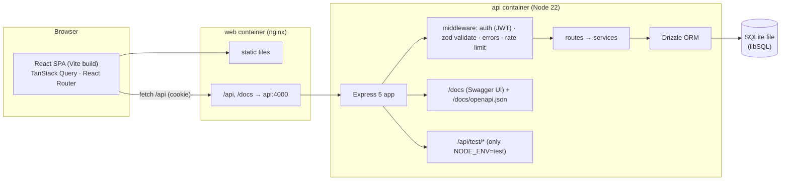

# TaskFlow — PLAN.md

> Handoff document for `taskflow-web-app`. **Every model reads this first** and follows it instead of re-deriving the design.
> Source spec: `../fable-portfolio-spec.md`, section 1 (plus ground rules in section 0).
> When you finish a task in section 11: tick its box and add a one-line note. If a task needs a design decision that is not in this file, **stop and ask** — do not improvise.

---

## 1. Goals

TaskFlow is a small, polished task and project tracker for small teams. It has two jobs:

1. **Be a convincing product.** Clients open the live demo first. It must look like something a startup would sell.
2. **Be an excellent system under test.** Repo 2 (`playwright-jenkins-e2e`) automates it, so it needs stable test ids, deterministic seed data, isolated test workspaces and predictable API errors.

It is a **personal portfolio project** and the README says so. No fake clients, testimonials or results.

Non-goals: real email sending, real-time sync (websockets), file uploads, billing, multi-tenant organisations, i18n.

---

## 2. Architecture



### Key decisions (do not change without asking)

| Area | Decision | Why |
|---|---|---|
| Monorepo | npm workspaces: `api`, `web`. Root holds scripts, Docker, CI. | Spec. npm is already installed; no pnpm. |
| Node | **22 LTS** in Docker, CI and `.nvmrc`. `engines: >=22`. Must also work on the dev machine's Node 26. | LTS for reproducibility. |
| API framework | Express 5 + TypeScript (ESM, `tsx` in dev, `tsc` build). | Most widely recognised by clients. |
| DB | SQLite through **Drizzle ORM + `@libsql/client`** (`file:` URL; `:memory:` in tests). Migrations generated by `drizzle-kit`, applied on startup. | libSQL ships N-API prebuilds, so no native compile on Windows / Node 26 (unlike `better-sqlite3`). If it fails to install on Node 26, stop and report. |
| Validation | Zod on every body, query and params. | Spec. |
| OpenAPI | `@asteasolutions/zod-to-openapi` builds the spec from the same Zod schemas. Swagger UI at `/docs`, JSON at `/docs/openapi.json`. | One source of truth. |
| Auth | JWT (HS256, 7 days) in an **httpOnly cookie** `tf_token` (`SameSite=Lax`). The API **also accepts `Authorization: Bearer`**; login/signup return the token in the body. | Cookie for the browser, Bearer for API tests in repo 2. |
| Passwords | `bcryptjs`, cost 10 (cost 4 when `NODE_ENV=test`). | Pure JS, no native build. |
| Same origin | The browser always talks to `/api` on its own origin: Vite dev proxy locally, nginx proxy in compose, Express serving the web build in the single-image deploy. | No CORS or third-party-cookie problems. |
| Web | React 19, Vite, TypeScript strict, **Tailwind v4** (tokens in CSS `@theme` + CSS variables), shadcn/ui + Radix, lucide-react. | Spec. |
| Web data | TanStack Query for server state, React Router 7 (library mode), react-hook-form + Zod for forms. API types generated with `openapi-typescript` from `/docs/openapi.json` into `web/src/api/schema.d.ts`. | Contract stays in sync with the API. |
| Web libs | `@dnd-kit/core` + `sortable`, `motion` (Framer Motion), Recharts, `cmdk`, `sonner` (toasts), `date-fns`, `react-markdown` + `rehype-sanitize`. | Spec. |
| Rich description | **Markdown** with Write / Preview tabs (sanitised render). No WYSIWYG editor. | Looks rich, stays testable and light. |
| Font | Inter Variable, self-hosted via `@fontsource-variable/inter`. | No external font CDN. |
| Deploy | One Docker image (`Dockerfile` at root): API serves the web build when `SERVE_WEB_DIR` is set. Target: Render free web service via `render.yaml`. Needs the owner's account → `DEPLOY.md`. | One free service, one origin. |
| Demo data on the live host | Free hosts have ephemeral disks, so the DB is reseeded on boot when empty and every `DEMO_RESET_INTERVAL_MINUTES`. README says the demo resets. | Honest and self-healing. |

---

## 3. Folder structure

```
taskflow-web-app/
├─ PLAN.md  README.md  DEPLOY.md  LICENSE  .env.example
├─ package.json            # workspaces + root scripts (dev, lint, typecheck, test, build, screenshots)
├─ docker-compose.yml      # api + web, one command
├─ docker-compose.test.yml # override: NODE_ENV=test (used by repo 2)
├─ Dockerfile              # single-image deploy (api serves web)
├─ render.yaml
├─ .github/workflows/ci.yml
├─ .gitleaks.toml
├─ docs/                   # screenshots/, TEST_IDS.md, architecture notes
├─ scripts/screenshots.ts  # Playwright script: every page × light/dark × desktop/mobile
├─ api/
│  ├─ Dockerfile  package.json  tsconfig.json  vitest.config.ts  drizzle.config.ts
│  ├─ drizzle/                    # generated SQL migrations
│  └─ src/
│     ├─ index.ts                 # reads env, starts server
│     ├─ app.ts                   # createApp({ db, env }) — no listen(), used by tests
│     ├─ env.ts                   # Zod-parsed environment
│     ├─ db/        schema.ts  client.ts  migrate.ts  seed.ts  seed-data.ts
│     ├─ middleware/ auth.ts  requireRole.ts  validate.ts  error.ts  rateLimit.ts
│     ├─ lib/       errors.ts  jwt.ts  password.ts  dates.ts  position.ts  ids.ts
│     ├─ schemas/   *.schema.ts   # Zod, registered with OpenAPI
│     ├─ services/  auth  users  projects  members  tasks  comments  dashboard  search  permissions
│     ├─ routes/    auth  users  projects  tasks  comments  dashboard  search  health  test  docs
│     └─ openapi.ts
│  └─ tests/  unit/  integration/  helpers/
└─ web/
   ├─ Dockerfile  nginx.conf  package.json  vite.config.ts  index.html
   ├─ public/      favicon.svg  landing/*.png
   └─ src/
      ├─ main.tsx  App.tsx  router.tsx
      ├─ styles/   tokens.css  globals.css
      ├─ api/      client.ts  schema.d.ts  queries/*.ts   # one file per resource
      ├─ lib/      testids.ts  dates.ts  shortcuts.ts  cn.ts
      ├─ components/
      │  ├─ ui/        # shadcn primitives, themed
      │  ├─ brand/     Logo.tsx  Wordmark.tsx
      │  ├─ layout/    AppShell  Sidebar  TopBar  BottomNav  CommandPalette  ShortcutsDialog
      │  ├─ tasks/     TaskCard  TaskPanel  TaskForm  PriorityBadge  StatusBadge  DueDate  LabelChip
      │  ├─ board/     Board  BoardColumn  SortableTaskCard
      │  ├─ list/      TaskTable  TaskFilters
      │  ├─ dashboard/ StatCard  StatusChart  CompletedChart  OverdueList
      │  └─ common/    Avatar  EmptyState  Skeletons  ErrorState  illustrations/
      ├─ pages/    Landing  Login  Signup  Dashboard  MyTasks  ProjectBoard  ProjectList
      │            ProjectSettings  Settings  NotFound
      ├─ hooks/    useAuth  useTheme  useShortcuts  useMediaQuery
      └─ test/     setup.ts  msw/  *.test.tsx next to components
```

---

## 4. Data model

IDs are 12-char nanoid strings. Timestamps are ISO strings (UTC). `dueDate` is a date-only string `YYYY-MM-DD`.

| Table | Columns |
|---|---|
| `users` | `id`, `email` (unique, lowercased), `name`, `passwordHash`, `role` (`admin` \| `member`), `avatarColor`, `isProtected` (bool; seeded demo accounts), `createdAt` |
| `projects` | `id`, `name`, `key` (2–4 uppercase letters, e.g. `WEB`), `description`, `color`, `ownerId` → users, `createdAt`, `updatedAt` |
| `project_members` | `projectId`, `userId` (composite PK), `createdAt` |
| `invites` | `id`, `projectId`, `email`, `invitedById`, `createdAt`; unique (`projectId`, `email`) |
| `tasks` | `id`, `projectId`, `number` (per-project counter → shown as `WEB-12`), `title`, `description` (markdown), `status` (`todo` \| `in_progress` \| `done`), `priority` (`low` \| `medium` \| `high` \| `urgent`), `dueDate` (nullable), `assigneeId` (nullable), `position` (real), `createdById`, `createdAt`, `updatedAt`, `completedAt` (nullable) |
| `labels` | `id`, `projectId`, `name`, `color` |
| `task_labels` | `taskId`, `labelId` (composite PK) |
| `comments` | `id`, `taskId`, `authorId`, `body`, `createdAt` |
| `activity` | `id`, `taskId`, `actorId`, `type` (`created` \| `status_changed` \| `priority_changed` \| `assigned` \| `due_changed` \| `renamed` \| `commented`), `data` (JSON: `from`, `to`), `createdAt` |

All foreign keys cascade on delete, except `tasks.assigneeId` which is set to null.

### Business rules

- **Roles are global.** `admin` sees and manages every project and all users. `member` sees only projects they own or belong to.
- **Project owner** (the creator) can rename/delete the project and invite/remove its members. Admin can do the same on any project.
- Any project member can create, edit, move and delete tasks and comments in that project. Comments can be deleted by their author or an admin.
- **Invites are stored only.** If the invited email already has an account, the user is added as a member immediately. Otherwise an `invites` row is kept and applied automatically when that email signs up.
- **Assignee** must be a member of the task's project (else 400).
- **Ordering**: `position` is a float. Moving a card sets it to the midpoint between its new neighbours (helper in `lib/position.ts`); new tasks go to the end of their column.
- `completedAt` is set when status becomes `done` and cleared when it leaves `done`.
- **Overdue** = `dueDate < today` and `status != done`. "Today" is the **UTC date** on both server and client (shared rule, one helper each). Document this in the README.
- **Protected accounts** (`isProtected`): cannot be deleted, demoted, or have their password or email changed. This keeps the public demo usable.
- Password rule: at least 8 characters, one letter, one digit. Email is trimmed and lowercased.

---

## 5. API contract

Base path `/api`. JSON only. All routes need auth except `health`, `auth/signup`, `auth/login` and `test/*`.

### Error format (every non-2xx)

```json
{ "error": { "code": "VALIDATION_ERROR", "message": "Invalid request", "details": [{ "path": "email", "message": "Enter a valid email" }] } }
```

| Status | `code` | When |
|---|---|---|
| 400 | `VALIDATION_ERROR` | Zod failure (with `details`) or broken business rule |
| 401 | `UNAUTHENTICATED` | No/invalid/expired token; wrong email or password on login |
| 403 | `FORBIDDEN` | Authenticated but not allowed (not admin, not owner, **not a member of an existing project**) |
| 404 | `NOT_FOUND` | Resource or route does not exist |
| 409 | `CONFLICT` | Email already registered; member/invite already exists |
| 429 | `RATE_LIMITED` | Too many login attempts (10 per minute per IP; **disabled when `NODE_ENV=test`**) |

### Endpoints

| Method & path | Notes |
|---|---|
| `GET /health` | `{ status: "ok", version, uptime, db: "ok" }` |
| `POST /auth/signup` | `{ name, email, password }` → 201 `{ user, token }`, sets cookie. New users are `member`. Applies pending invites. |
| `POST /auth/login` | `{ email, password }` → 200 `{ user, token }`, sets cookie |
| `POST /auth/logout` | 204, clears cookie |
| `GET /auth/me` | current user |
| `PATCH /auth/me` | `{ name?, currentPassword?, newPassword? }` |
| `GET /users` | **admin** — all users with project counts |
| `PATCH /users/:id` | **admin** — `{ role }` |
| `DELETE /users/:id` | **admin** — 204. Cannot delete self or a protected account (400). |
| `GET /projects` | member: own + joined; admin: all. Includes task counts per status and member count. |
| `POST /projects` | `{ name, description?, color? }` → 201. `key` derived from the name, unique. |
| `GET /projects/:id` | project + members + labels |
| `PATCH /projects/:id` | owner/admin — `{ name?, description?, color? }` |
| `DELETE /projects/:id` | owner/admin — 204 |
| `GET /projects/:id/members` | members + pending invites |
| `POST /projects/:id/invites` | owner/admin — `{ email }` → 201 `{ member }` or `{ invite }` |
| `DELETE /projects/:id/invites/:inviteId` | owner/admin |
| `DELETE /projects/:id/members/:userId` | owner/admin — cannot remove the owner (400). Unassigns that user's tasks in the project. |
| `GET /projects/:id/tasks` | Query: `status`, `priority`, `assignee` (user id \| `me` \| `none`), `label`, `q` (title/description, case-insensitive), `overdue=true`, `sort` (`position` \| `dueDate` \| `priority` \| `createdAt` \| `title`), `order` (`asc` \| `desc`). Default `position asc`. Null due dates sort last. |
| `POST /projects/:id/tasks` | `{ title, description?, status?, priority?, dueDate?, assigneeId?, labelIds? }` → 201 |
| `GET /tasks` | Tasks across my projects. Same filters; used by "My tasks" with `assignee=me`. |
| `GET /tasks/:id` | task + labels + comments + activity |
| `PATCH /tasks/:id` | any task field, plus `position`. Writes activity rows. |
| `DELETE /tasks/:id` | 204 |
| `POST /tasks/:id/comments` | `{ body }` → 201 |
| `DELETE /comments/:id` | author/admin |
| `GET /projects/:id/labels` · `POST /projects/:id/labels` | list / create `{ name, color }` |
| `GET /dashboard` | `{ counts: { todo, in_progress, done, overdue }, byPriority, completedByDay (last 14 days), overdue: Task[], myTasks: Task[] }` scoped to visible projects |
| `GET /search?q=` | `{ projects: [], tasks: [] }` (max 8 each) for the command palette |
| `GET /docs` · `GET /docs/openapi.json` | Swagger UI / spec (served at root, not under `/api`) |

Task objects in lists always include: `id`, `key` (`WEB-12`), `projectId`, `title`, `status`, `priority`, `dueDate`, `position`, `assignee` (`{ id, name, avatarColor }` or null), `labels`, `commentCount`, `createdAt`, `updatedAt`.

### Test-only endpoints (`NODE_ENV=test`, otherwise the router is **not mounted** → 404)

| Endpoint | Behaviour |
|---|---|
| `POST /api/test/reset` | Wipes all tables. Body `{ seed?: "demo" \| "none" }` (default `demo`). **Global — not parallel-safe.** For serial suites and local use. |
| `POST /api/test/seed` | Body `{ scenario: "workspace" \| "demo", tasks?: number }`. `workspace` (default) creates an **isolated workspace with unique emails**: one admin, one member (project member), one outsider (not a project member), one project with labels and a fixed set of tasks covering every status, priority, an overdue task, a due-today task and an unassigned task. Returns `{ admin, member, outsider }` each as `{ id, email, password }`, plus `project` and `tasks`. **Parallel-safe**: members only see their own workspace. |

Note for repo 2: admins see *all* projects, so admin-view assertions must target the seeded project by id/name, not by total counts.

A required unit/integration test proves both endpoints return 404 when `NODE_ENV` is `production` or `development`, and work when it is `test`.

### Environment variables (`.env.example`, placeholders only)

| Var | Default | Notes |
|---|---|---|
| `NODE_ENV` | `development` | `test` enables `/api/test/*`, disables rate limiting |
| `PORT` | `4000` | API port |
| `DATABASE_URL` | `file:./data/taskflow.db` | `:memory:` in tests |
| `JWT_SECRET` | — | **Required** when `NODE_ENV=production` (startup fails without it). Dev/test use a clearly named insecure default. |
| `JWT_EXPIRES_IN` | `7d` | |
| `COOKIE_SECURE` | `false` | `true` behind HTTPS |
| `SEED_ON_START` | `true` | Seed demo data if the DB is empty |
| `DEMO_RESET_INTERVAL_MINUTES` | `0` (off) | Live demo: `60` |
| `SERVE_WEB_DIR` | unset | Single-image deploy: path to the web build |
| `WEB_PORT` | `8080` | compose: published web port |
| `API_PROXY_TARGET` | `http://localhost:4000` | Vite dev proxy target |

The demo passwords (`Demo123!`, `Member123!`) are public by design and live in seed code and the login page. Add them to the gitleaks allowlist if flagged; nothing else is ever allowlisted.

---

## 6. Seed data (demo scenario)

Invented people only. Everything must look believable.

- **Users**: `demo@taskflow.dev` / `Demo123!` — *Alex Morgan*, **admin**, protected. `member@taskflow.dev` / `Member123!` — *Sam Rivera*, **member**, protected. Plus 4 more members (e.g. Priya Shah, Jonas Weber, Mei Tanaka, Lucas Oliveira) with their own colours.
- **Projects**: *Website Redesign* (`WEB`), *Mobile App Launch* (`APP`), *Q1 Marketing Campaign* (`MKT`). Sam is a member of the first two only (so role differences are visible).
- **Tasks**: 12–16 per project, spread over all statuses and priorities, with realistic titles ("Audit current landing page copy", "Fix checkout button contrast on mobile"), markdown descriptions on about half, labels (`design`, `frontend`, `backend`, `bug`, `content`, `research`), 0–4 comments, activity history.
- **Dates are relative to the seed time**: 3–4 overdue, 2 due today, 2 due tomorrow, others within three weeks, some without a date. Completed tasks are spread over the last 14 days so the dashboard chart has a real shape.
- One pending invite on *Website Redesign*.

---

## 7. Design system

Quality bar: modern work tools (calm, dense, precise). TaskFlow has its **own** identity — do not copy another product's branding, layout or copy.

### Brand

- **Name**: TaskFlow. **Wordmark**: Inter 600, letter-spacing −0.02em, "Task" in foreground colour, "Flow" in accent.
- **Logo** (`Logo.tsx`, inline SVG, 24×24 viewBox): rounded square (radius 6) filled with the accent; inside, three white rounded bars of equal height, each one shorter and shifted further right than the one above — tasks flowing forward. Also used as `favicon.svg`.
- **Voice**: short, plain, friendly. "No tasks here yet." not "Oops! Looks like…".

### Colour tokens (CSS variables in `tokens.css`, mapped into Tailwind `@theme`)

| Token | Light | Dark | Use |
|---|---|---|---|
| `--bg` | `#F7F8FA` | `#0E1014` | app background |
| `--surface` | `#FFFFFF` | `#15181E` | cards, panels, sidebar |
| `--surface-2` | `#F1F3F6` | `#1C2028` | hover, columns, inputs |
| `--border` | `#E3E6EB` | `#272C36` | hairlines |
| `--border-strong` | `#CBD0D8` | `#3A4150` | inputs, dividers that matter |
| `--fg` | `#14171C` | `#ECEEF2` | primary text |
| `--fg-muted` | `#5B6472` | `#9AA3B2` | secondary text |
| `--fg-subtle` | `#646E7D` | `#7F8898` | placeholders, meta (still AA on its surface) |
| `--accent` | `#2F5BEA` | `#2F5BEA` | primary buttons (white text), active states — "Flow Blue" |
| `--accent-hover` | `#2449C8` | `#4369EE` | |
| `--accent-fg` | `#2F5BEA` | `#8FA5FF` | accent-coloured text, links, icons |
| `--accent-soft` | `#EAF0FF` | `#1A2444` | selected rows, soft badges |
| `--success` / `-soft` | `#15803D` / `#E7F6EC` | `#4ADE80` / `#12301F` | done |
| `--warning` / `-soft` | `#B45309` / `#FDF3E1` | `#FBBF24` / `#33260B` | due soon, high priority |
| `--danger` / `-soft` | `#DC2626` / `#FDECEC` | `#F87171` / `#3A1616` | overdue, urgent, destructive |
| `--ring` | `#2F5BEA` | `#8FA5FF` | focus ring: 2px + 2px offset, always visible on `:focus-visible` |

Rules: one accent only. Colour is never the only signal — status and priority always pair colour with an icon and a text label. Every text/background pair must pass **WCAG AA** in both themes; verify with axe during the review task, and adjust the token (not the component) if one fails.

**Status**: `todo` — neutral, `Circle` icon · `in_progress` — accent, `CircleDashed`/half icon · `done` — success, `CheckCircle2`.
**Priority**: `urgent` — danger, `AlertOctagon` · `high` — warning, `SignalHigh` · `medium` — accent-fg, `SignalMedium` · `low` — muted, `SignalLow`.
**Avatars**: initials on one of 8 fixed background colours (`avatarColor`), white text, all AA.
**Labels**: small chips, soft tinted background + coloured dot, 8 preset colours.

### Type, spacing, shape

- **Type scale** (px / line-height): 12/16 · 13/18 · **14/20 (UI base)** · 16/24 · 18/26 · 20/28 · 24/32 · 30/38 · 36/44 · 48/56 (landing hero; 36 on mobile). Weights 400, 500, 600. Headings −0.01em to −0.02em tracking.
- **Numbers**: `font-variant-numeric: tabular-nums` on the dashboard, task keys, counts and dates.
- **Spacing**: 4px base (4, 8, 12, 16, 20, 24, 32, 40, 48, 64, 96). Page padding 24 desktop / 16 mobile. Minimum touch target 40px on mobile.
- **Radius**: 6 (inputs, buttons, chips) · 8 (cards) · 12 (dialogs, panels) · 16 (landing screenshot frame) · full (avatars, pills).
- **Shadows**: `xs` (cards at rest: 0 1px 2px / 6%), `sm` (hover), `md` (popovers), `lg` (dialogs, command palette), `drag` (lifted card: larger, plus 1.02 scale and 1.5° tilt). Dark mode relies on borders more than shadows.
- **Motion** (`motion`): 120–200ms, ease-out. Page transition = 8px fade-up. Dialog = fade + scale from 0.97. Side panel = slide from right. Toast = slide up. Card drop = spring settle; columns highlight on drag-over. Everything collapses to instant/opacity-only under `prefers-reduced-motion`.

### Components

shadcn/ui primitives, restyled to the tokens (no default shadcn look): Button (primary, secondary, ghost, danger; sm/md), Input, Textarea, Select, Checkbox, Dialog, Sheet, DropdownMenu, Popover, Tooltip, Tabs, Badge, Avatar, Skeleton, Command, Calendar/date picker, Sonner toasts, Table.

### Pages and layout

| Route | Layout |
|---|---|
| `/` **Landing** | Sticky top nav (logo, "Log in", primary "Try the demo"). Hero: headline, one-line subhead, two buttons, then a large framed **real product screenshot** of the board (light/dark variant follows theme) with a soft accent glow behind it. Three-by-two feature grid (icon, title, one line). A second screenshot band (dashboard + mobile side by side). Honest footer: "A personal portfolio project by Mikayel Vasilyan", GitHub link, API docs link. No testimonials, no logos, no made-up numbers. "Try the demo" logs in as the demo user in one click. |
| `/login`, `/signup` | **Split layout.** Left: logo, form, inline validation, link to the other form. Login shows a "Demo accounts" box with two one-click buttons (Admin demo, Member demo) and the visible credentials. Right (hidden under 1024px): accent-tinted panel with a cropped product visual and a short value line. |
| `/app/*` **App shell** | Left **sidebar** (240px, collapsible to a 56px icon rail, state remembered): logo, Dashboard, My tasks, "Projects" list with colour dots and a "+" button, Settings at the bottom. **Top bar**: page title/breadcrumb, search field that opens the command palette (shows `Ctrl K`), theme toggle, user menu (name, role badge, settings, log out). Content area scrolls; the page itself never scrolls horizontally. |
| `/app/dashboard` | Greeting line. Four **stat cards** (To do, In progress, Done, Overdue) with tabular numbers. Two charts in cards: tasks by status (donut or bar) and completed per day for 14 days (area). Below: "Overdue" list and "My tasks" list, each with its own empty state. |
| `/app/my-tasks` | Tasks assigned to me across projects, grouped: Overdue, Today, Upcoming, No date. |
| `/app/projects/:id/board` | Header: colour dot, project name, member avatars, Board / List tabs, filter button, "New task". **Three columns** (To do, In progress, Done) with count and a "+" button; cards are sortable within and across columns. **Task card**: key (`WEB-12`), title (max 2 lines), label chips, then a footer row with priority icon, due date (relative, coloured when overdue/soon), comment count, assignee avatar. Keyboard drag supported (dnd-kit keyboard sensor with screen-reader announcements); each card also has a "Move to…" menu as a non-drag alternative. |
| `/app/projects/:id/list` | Filter bar (search, status, assignee, priority, "Overdue only", clear) + sortable table (key, title, status, priority, assignee, due). Filters and sort live in the URL query string. On mobile the table becomes stacked rows. |
| `?task=<id>` **Task panel** | Right side sheet (480px; full screen on mobile) over the board or list. Editable title, status / priority / assignee / due date / labels as property rows, markdown description with Write/Preview, comments with composer, activity log with relative times. Delete in an overflow menu with confirm dialog. Deep-linkable and closes with `Esc`. |
| `/app/projects/:id/settings` | Rename, description, colour; members list with remove; invite by email; pending invites; danger zone (delete with typed confirmation). Owner/admin only — others see a read-only members list. |
| `/app/settings` | Tabs: **Profile** (name, change password), **Appearance** (Light / Dark / System cards), **Members** (admin only: all users, role select, remove). The Members tab is not rendered for members. |
| `*` | 404 page with a small illustration and "Back to dashboard" / "Back home". Unknown `/app` routes use the same page inside the shell. |

**Mobile (<768px)**: sidebar is replaced by a **bottom navigation** (Dashboard, My tasks, Projects, Search, Settings). Board columns become a horizontal **scroll-snap** carousel inside the board area (one column ≈ 86% width, with a column indicator); the page body does not scroll sideways. Drag on touch uses a 200ms long-press. Dialogs become bottom sheets. **Tablet (768–1023px)**: sidebar starts collapsed to the icon rail; board shows all three columns.

**States everywhere**: skeleton loaders shaped like the real content (cards, rows, stat cards); empty states with a small inline SVG illustration, one line of text and one action; error state with retry; buttons show a spinner and disable while submitting; optimistic updates for card moves with rollback + error toast on failure.

**Command palette** (`Ctrl/Cmd+K`): search projects and tasks (`/api/search`), plus actions (New task, New project, Go to dashboard, Go to my tasks, Toggle theme, Log out).
**Shortcuts**: `c` new task · `/` open search · `g` then `d` dashboard · `g` then `m` my tasks · `[` toggle sidebar · `?` shortcuts dialog · `Esc` close panel. Disabled while typing in a field.
**Relative dates** (`lib/dates.ts`): "Today", "Tomorrow", "Yesterday", "in 5 days", "2 days overdue", otherwise "Mar 14". Full date in a tooltip and `title`.

---

## 8. Conventions

### `data-testid`

- Every interactive element and every element a test would assert on gets one. Kebab-case: `<area>-<element>[-<qualifier>]`.
- All ids are defined in **`web/src/lib/testids.ts`** (constants and small builder functions) — never typed inline. `docs/TEST_IDS.md` lists them for repo 2.
- Entities carry the id in the test id **and** state in data attributes:
  `task-card-{taskId}` with `data-status`, `data-priority`, `data-overdue` · `board-column-{status}` with `data-count` · `project-link-{projectId}` · `task-row-{taskId}` · `member-row-{userId}`.
- Forms: `{form}-{field}-input`, `{form}-{field}-error`, `{form}-submit`, `{form}-error` (server error). Example: `login-email-input`, `login-password-error`, `login-submit`.
- Global: `toast-success`, `toast-error`, `user-menu`, `user-menu-logout`, `theme-toggle`, `command-palette`, `command-palette-input`, `sidebar`, `sidebar-toggle`, `bottom-nav`, `task-panel`, `confirm-dialog`, `confirm-dialog-confirm`, `empty-state-{name}`, `skeleton-{name}`, `not-found-page`.

### Code

- TypeScript `strict` (+ `noUncheckedIndexedAccess`) in both packages. No `any` without a comment explaining why.
- ESLint (typescript-eslint, react-hooks, jsx-a11y) + Prettier. `npm run lint`, `typecheck`, `test`, `build` work from the root for both workspaces.
- API layering: **route** (HTTP only) → **service** (rules, permissions) → **Drizzle**. Routes never touch the DB directly. Errors are thrown as `AppError(code, message, details?)` and formatted by one error middleware.
- Web: server state only in TanStack Query; no global store. One query-key factory per resource. Components are presentational where possible; pages own data.
- Accessibility: labels on every input, `aria-*` on custom controls, focus trapped in dialogs and returned on close, logical heading order, landmarks (`nav`, `main`), skip-to-content link.
- Commits: small and logical, Conventional Commits (`feat(api): …`, `test(web): …`). Author `Mikayel Vasilyan <mikayelvasilyan@users.noreply.github.com>` (already set in this repo's local git config). No backdating. **Do not push** until the owner says so.
- No secrets in code. Only `.env.example` is committed.

---

## 9. Test strategy (inside this repo)

End-to-end tests live in repo 2. Here:

| Layer | Tools | What |
|---|---|---|
| API unit | Vitest | `position`, `dates` (overdue, UTC edge), permissions matrix, env parsing (prod without `JWT_SECRET` fails), project key generation, password rule |
| API integration | Vitest + Supertest, fresh in-memory DB per test file via `createApp({ db, env })` | Every endpoint: happy path, validation (table-driven negative cases), 401, 403 (member vs admin vs outsider), 404, 409; cookie **and** Bearer auth; invites applied on signup; filters/search/sort; activity rows; protected accounts; dashboard numbers against known seed; **test routes 404 unless `NODE_ENV=test`**; OpenAPI document is valid and lists every route |
| Web component | Vitest + Testing Library + MSW (jsdom) | Login/signup validation and server errors, protected-route redirect, TaskCard rendering (overdue, priority, assignee), filter bar ↔ URL, relative date helper, theme toggle persistence, board renders columns/counts and "Move to…" changes status, empty/skeleton/error states, admin-only UI hidden for members, 404 page |

- **Coverage**: API thresholds enforced in `vitest.config.ts` — 80% lines, functions, statements; 75% branches. Web: no hard threshold, report only.
- **Visual check**: `scripts/screenshots.ts` (Playwright, dev dependency at root) logs in and captures every page in light/dark × desktop (1440×900) / mobile (390×844) into `docs/screenshots/`. It doubles as a smoke run: it fails if any page logs a console error.
- README results must be pasted from a **real run** (counts, coverage, duration).

---

## 10. CI, Docker, deploy

- **`docker-compose.yml`**: `api` (Node 22 alpine/slim, named volume for the SQLite file, healthcheck on `/api/health`) and `web` (nginx serving the Vite build, proxying `/api` and `/docs` to `api`). `docker compose up` → app on `http://localhost:8080`. `NODE_ENV` defaults to `production`; `docker-compose.test.yml` overrides it to `test` for repo 2.
- **Root `Dockerfile`**: multi-stage, builds both, final image runs the API with `SERVE_WEB_DIR` (SPA fallback to `index.html` for non-API routes).
- **GitHub Actions `ci.yml`** (push + PR): jobs `lint`, `typecheck`, `test-api` (with coverage artifact), `test-web`, `build`, `docker` (compose build + health smoke), `secret-scan` (gitleaks). Node 22, npm cache.
- **Deploy**: `render.yaml` blueprint + `DEPLOY.md` with exact click-by-click steps. Deploying needs the owner's Render account — **ask first**, and say plainly in the README if the demo is not live yet ("Live demo: coming soon").

---

## 11. Task list

Legend: `[Fable]` design and review · `[Opus]` Docker/CI/hard bugs · `[Sonnet]` implementation · `[Haiku]` boilerplate.
Run the relevant tests after each task and commit before ticking the box.

### Phase A — Foundation
- [x] 1. `[Fable]` Write `PLAN.md`. — *Done; repo initialised locally with the noreply author and `origin` remote, nothing committed or pushed.*
- [x] 2. `[Haiku]` Boilerplate: `LICENSE` (MIT, Mikayel Vasilyan), `.gitignore`, `.editorconfig`, `.nvmrc` (22), `.prettierrc`, `.env.example` (section 5), root `package.json` with workspaces and scripts. — *Done.*
- [x] 3. `[Sonnet]` API scaffold: TypeScript strict, ESLint, Vitest, `env.ts`, `createApp`, error middleware and `AppError`, `GET /api/health` + test. — *Done: Express 5 app factory, error middleware, health, 10 tests.*
- [x] 4. `[Sonnet]` DB: Drizzle schema (section 4), libSQL client, first migration, migrate-on-start, in-memory test helper. **If `@libsql/client` fails on Node 26/Windows, stop and report.** — *Done: libSQL works on Node 26 (no native compile); FK cascade verified.*

### Phase B — API
- [x] 5. `[Sonnet]` Auth: signup, login, logout, me, update me; JWT cookie + Bearer; bcryptjs; login rate limit; tests. — *Done: 18 auth tests (cookie + Bearer, rate limit, validation).*
- [x] 6. `[Sonnet]` Permissions service + `requireRole`; users endpoints (admin); protected accounts; tests incl. permission matrix. — *Done: permission helpers, admin user endpoints, protected accounts.*
- [x] 7. `[Sonnet]` Projects, members, invites (incl. invite applied on signup); tests. — *Done: projects, members, invites (applied on signup), labels. 53 API tests total.*
- [x] 8. `[Sonnet]` Tasks: CRUD, filters/search/sort, position, `completedAt`, activity log, labels, comments; tests. — *Done: filters, search (wildcards escaped), sort with nulls last, positions, activity, labels, comments. 90 API tests total.*
- [x] 9. `[Sonnet]` Dashboard + search endpoints; tests against known data. — *Done: dashboard + search, scoped by role, tested against known data.*
- [x] 10. `[Sonnet]` Seed: demo scenario (section 6) and `workspace` scenario; `SEED_ON_START`; periodic demo reset. — *Done: demo seed (3 projects, 36 tasks, 4 overdue, 2 due today, 2 tomorrow, 15 completions) + isolated workspace scenario. Smoke-tested on the real server.*
- [x] 11. `[Sonnet]` Test routes `reset` / `seed`, mounted only in `NODE_ENV=test`; test proving 404 otherwise. — *Done: reset + seed routes, 404 proven for development and production.*
- [x] 12. `[Sonnet]` OpenAPI from Zod, Swagger UI at `/docs`; test that the spec is valid and complete. — *Done: 30 routes documented, spec validated, completeness test scans route files. UI at /docs, JSON at /docs/openapi.json.*
- [x] 13. `[Sonnet]` API coverage ≥ thresholds; fill gaps. Record real numbers for the README. — *Done (real run): 110 tests, 11 files; coverage lines 96.19%, statements 95.81%, branches 92.71%, functions 89.75%; thresholds enforced in vitest.config.ts.*

### Phase C — Web foundation
- [x] 14. `[Sonnet]` Web scaffold: Vite + React + TS strict, Tailwind v4, ESLint (jsx-a11y), Vitest + Testing Library + MSW, dev proxy. — *Done.*
- [x] 15. `[Sonnet]` Design tokens (`tokens.css`, section 7) for light/dark, Inter, Tailwind theme mapping, `useTheme` (Light/Dark/System, persisted, no flash on load). — *Done.*
- [x] 16. `[Sonnet]` shadcn/ui primitives restyled to the tokens; `Logo`, `Wordmark`, `favicon.svg`; `Avatar`, `EmptyState` + illustrations, skeletons. — *Done.*
- [x] 17. `[Fable]` **Design checkpoint**: review tokens and primitives on a temporary `/kitchen-sink` route in both themes; adjust tokens before pages are built. — *Superseded: never run on a `/kitchen-sink` route; the task 32 visual review covered tokens and primitives on the real pages.*
- [x] 18. `[Sonnet]` API client, generated types (`openapi-typescript`), query hooks, `testids.ts`, auth context, protected routes, router with page transitions. — *Done: generated types via npx openapi-typescript (not a dependency; TS 5 peer conflict). Auth fix: keep the `me` query when clearing the cache on login.*

### Phase D — Web features
- [x] 19. `[Sonnet]` Login + signup (split layout, demo-account buttons, inline validation, server errors); component tests. — *Done, verified in a real browser (login, dashboard, drag-and-drop move persisted, task panel deep link).*
- [x] 20. `[Sonnet]` App shell: sidebar (collapsible), top bar, user menu, bottom nav on mobile, new-project dialog, toasts, 404 page. — *Done, verified in a real browser (login, dashboard, drag-and-drop move persisted, task panel deep link).*
- [x] 21. `[Sonnet]` Kanban board with dnd-kit (pointer, touch, keyboard), optimistic moves with rollback, "Move to…" menu, new-task dialog, mobile scroll-snap columns; tests. — *Done, verified in a real browser (login, dashboard, drag-and-drop move persisted, task panel deep link).*
- [x] 22. `[Sonnet]` Task panel (`?task=`): properties, markdown description, comments, activity, delete with confirm. — *Done, verified in a real browser (login, dashboard, drag-and-drop move persisted, task panel deep link).*
- [x] 23. `[Sonnet]` List view: filters, search, sorting, URL state, mobile stacked rows; tests. — *Done, verified in a real browser (login, dashboard, drag-and-drop move persisted, task panel deep link).*
- [x] 24. `[Sonnet]` Dashboard (stat cards, Recharts, overdue, my tasks) and My tasks page. — *Done, verified in a real browser (login, dashboard, drag-and-drop move persisted, task panel deep link).*
- [x] 25. `[Sonnet]` Project settings (rename, members, invites, delete) and Settings (profile, appearance, admin members); role-hidden UI tests. — *Done, verified in a real browser (login, dashboard, drag-and-drop move persisted, task panel deep link).*
- [x] 26. `[Sonnet]` Command palette, keyboard shortcuts, shortcuts dialog, relative dates everywhere. — *Done, verified in a real browser (login, dashboard, drag-and-drop move persisted, task panel deep link).*
- [x] 27. `[Opus]` Drag-and-drop hardening: verify pointer/touch/keyboard drag in a real browser, fix ordering or flicker bugs, confirm reduced-motion behaviour, make sure drag is automatable by Playwright (repo 2). — *Done: verified in Chrome via Playwright (14/14, run twice): mouse drag across and within columns, keyboard drag, touch long-press (quick swipe still scrolls), reduced motion, Move-to menu, no panel opened by drops, no horizontal page scroll on phones. Fixed: Left/Right keyboard moves now jump columns; move-menu test ids renamed to `task-move-*` so `task-card-*` matches cards only; flaky login test (1s findBy vs lazy Recharts import) fixed with a 5s async timeout.*

### Phase E — Docker, CI, deploy
- [x] 28. `[Opus]` `api/Dockerfile`, `web/Dockerfile` + `nginx.conf`, `docker-compose.yml`, `docker-compose.test.yml`, root `Dockerfile`; verify `docker compose up` end to end. — *Done: verified `docker compose up` (health, SPA routes, cached assets, /docs, cookie login, test routes 404 in production), the test override (seed/reset work on :4000 and via nginx) and the single image (API serves web build via SERVE_WEB_DIR). Empty env values now count as unset; compose opts into a per-start random JWT secret (ALLOW_EPHEMERAL_JWT_SECRET) so no secret is committed.*
- [x] 29. `[Opus]` GitHub Actions `ci.yml` (lint, typecheck, tests, build, docker smoke, gitleaks) + `.gitleaks.toml`. — *Done: jobs lint (+prettier), typecheck, test-api (coverage artifact), test-web, build, docker smoke (compose, test override, single image), gitleaks over full history. Verified locally: all Node steps pass in a clean node:22 Linux container (114 API + 23 web tests), docker smoke script passes, actionlint clean, gitleaks found no leaks (allowlist empty). Not yet run on GitHub (repo not pushed).*
- [x] 30. `[Opus]` `render.yaml` + `DEPLOY.md`. **Ask the owner before deploying.** — *Done: render.yaml (Docker, free plan, generated JWT_SECRET, hourly demo reset) and DEPLOY.md. Verified locally with Render-style env (PORT=10000, COOKIE_SECURE=true): healthy, Secure httpOnly cookie. Not deployed: needs the owner's Render account.*

### Phase F — Polish and review
- [x] 31. `[Sonnet]` `scripts/screenshots.ts`; capture all pages (light/dark × desktop/mobile) into `docs/screenshots/`. — *Done: `npm run screenshots` uses installed Chrome via playwright-core (no browser download); 44 PNGs in docs/screenshots, zero console errors.*
- [x] 32. `[Fable]` **Visual review** of every screenshot: list anything unfinished, cramped, misaligned or generic as numbered fixes below this list. — *Done: 44 fresh screenshots reviewed; 26 numbered fixes (V1–V26) under "Visual review fixes" below, grouped P1/P2/P3 and tagged by model.*
- [x] 33. `[Sonnet]` Apply the visual-review fixes; re-capture screenshots. — *Done: V1–V26 applied (V20 cards are not links; see note). 115 API + 25 web tests, lint, typecheck, build and prettier all green; drag checks 14/14 in Chrome after the board layout change; 72 screenshots re-captured with no console errors (Docker Desktop was not running, so the dev servers were used instead of docker compose).*
- [x] 34. `[Sonnet]` Landing page using the real screenshots (must come after 33). — *Done as review fixes V10 and V12: hero and second band use the real board and dashboard screenshots, theme-aware, with a phone frame on small screens.*
- [x] 35. `[Sonnet]` Accessibility pass: run axe on every page in both themes, fix serious/critical issues, check full keyboard use. — *Done: `npm run a11y` (axe-core on 62 page states: every page and open dialog, light/dark, desktop/phone, plus 11 keyboard checks). First run found 66 findings from 6 root causes, all fixed: light `--fg-subtle` contrast (#6E7786 to #646E7D), user-menu label, board cards no longer role=button around a button, Preview tab aria-controls, due-date/labels buttons, unassigned marker. Also found and fixed: dialogs opened from state never returned focus (regression test added). Final run: no findings at all.*
- [x] 36. `[Sonnet]` `docs/TEST_IDS.md` and `README.md` (pitch, screenshots/GIF desktop + mobile, live demo link or "coming soon", stack, Mermaid diagram, `docker compose up`, API docs link, test commands, **real** results, "personal portfolio project" label). — *Done: README (real results, honest limitations) and docs/TEST_IDS.md generated from testids.ts (`npm run docs:testids`). Screenshots in docs/ and web/public/landing predate the contrast-token tweak (visually negligible); re-capture before the final review if desired.*
- [x] 37. `[Haiku]` Formatting pass, remove the `/kitchen-sink` route, fix typos, check all README links. — *Done (Haiku): Prettier clean repo-wide; no `/kitchen-sink` route exists (only plan references, so nothing removed); relative links in README, DEPLOY, PLAN and TEST_IDS all resolve (the one apparent miss was a wrong check from the repo root, `docs/TEST_IDS.md` links are correct); word review of README and DEPLOY found no misspellings, and one British spelling (colour) changed to color to match the rest; openapi.json and the screenshots are intentionally tracked.*
- [x] 38. `[Fable]` **Final review** against the spec and this plan; confirm README numbers match a real run; list anything not finished or not verified. — *Done: see "Final review" below. README numbers confirmed against a real run; 6 gaps fixed; open items R1–R8 listed with owners.*

### Visual review fixes (task 32, Fable, 2026-11-10)

Reviewed all 44 screenshots (11 pages × light/dark × desktop 1440 / mobile 390), re-captured from the current build.
Overall: the foundation is solid (tokens, type, spacing, both themes are consistent and nothing is broken in dark mode).
What keeps it from the "real product" bar is a handful of weak details that repeat on every screen, plus the landing page.
Task 33 = do **P1 and P2** in order; P3 if time allows. Each fix names the decision, so no design questions should be needed.
Tick each box and re-run `npm run screenshots` at the end.

#### P1 — visible on almost every screen

- [x] **V1 `[Sonnet]` Priority icon is unreadable.** The lucide `Signal*` icons render as 1–3 tiny dots/bars (see every card, list row and dashboard row; "Low" looks like a speck). Replace with one custom `PriorityIcon` SVG (16×16): three vertical bars of heights 5/9/13px, width 3px, radius 1px, gap 2px, bottom-aligned. Filled bars use the priority colour, unfilled bars use `--border-strong`: low = 1 filled, medium = 2, high = 3. Urgent keeps the octagon-alert icon. Use it everywhere (`badges.tsx`), keep the sr-only text.
- [x] **V2 `[Sonnet]` Avatar stack clips initials** (project header, all viewports: "JV", "P", "MT", "SF"). In `AvatarStack` use overlap `-space-x-1` (not `-1.5`), keep the 2px surface ring, and render in reverse z-order so each avatar sits **under** the one to its left (first avatar fully visible). Size `sm` (24px) on desktop, `md` (32px) is too big; the "+N" chip gets the same ring and size.
- [x] **V3 `[Sonnet]` Avatar colours collide.** Alex Morgan and Jonas Weber are both slate, so they look like the same person on the board and in settings. In the demo seed assign fixed distinct colours per person (alex `#2F5BEA`, sam `#0E7490`, priya `#C2410C`, jonas `#475569`, mei `#7C3AED`, lucas `#A16207`); keep the hash for signed-up users.
- [x] **V4 `[Sonnet]` Task panel shows raw markdown.** The description opens in Write mode, so visitors see `## Scope` source text. Default to **Preview when a description exists**, Write when empty; rename the tabs "Preview" / "Edit". Make the textarea auto-grow to its content (min 6 rows, max ~16) so text is never cut mid-line.
- [x] **V5 `[Sonnet]` Task panel has a stray blue line down its left edge** (focus outline on the sheet container, light and dark). Remove the outline from the sheet/dialog content element only (`outline-none` on `SheetContent`/`DialogContent`); focus must still land inside the panel and stay visible on real controls.
- [x] **V6 `[Sonnet]` Due date in the panel is a raw native input** ("12/11/2026", ambiguous and inconsistent with "in 2 days" everywhere else). Show the relative label + short date as the value (e.g. "in 2 days · Nov 12", coloured by tone) in a button that opens a popover with the native date input and a "Clear" action. Keep `data-testid="task-due-input"` on the input.
- [x] **V7 `[Sonnet]` Page content starts at three different left edges.** Dashboard starts at x=288, Settings at 416, My tasks and Project settings at 480, while project headers start at 264. Rule: **all app pages are left-aligned** with the same gutter (24px desktop / 16px mobile, i.e. the project header's edge) and only cap their width (`max-w-6xl` dashboard, `max-w-4xl` settings, `max-w-3xl` my-tasks and project-settings). Remove `mx-auto` from `Page`.
- [x] **V8 `[Sonnet]` Phone: filters push the board/list below the fold** (search + 3 selects + checkbox take ~310px of 844). Under 768px show one row: the search field + a "Filters" button with an active-count badge (`data-testid="filters-toggle"`, already reserved). The button opens a bottom sheet with status, priority, assignee, overdue and Clear. Desktop stays as is. Same test ids for the controls inside the sheet.
- [x] **V9 `[Sonnet]` List view opens in a random-looking order** (WEB-1, WEB-7, WEB-10, WEB-2…) because it inherits board position. When no sort is chosen, the list sorts by status (to do, in progress, done) then board position — add `sort=status` to the API (asc: todo → in_progress → done, then position) with tests and OpenAPI update, and use it as the list default. The board keeps `position`.

#### P2 — specific screens

- [x] **V10 `[Sonnet]` Landing hero mock is the weakest thing in the product** and it is the first thing a client sees. Card titles are centred (inherits `text-center` from the hero), cards have no priority/assignee/due, and on phones it collapses (wrapped titles, missing "In progress" icon, no bars). For task 34: replace it with the **real board screenshot** (`board-{theme}-desktop.png`, theme-aware `<picture>`/two imgs, in a browser-style frame: 12px radius, 1px border, a 32px top bar with three dots, `shadow-lg`, max-width 1040px). On phones show the **mobile board screenshot** in a phone-style frame (max-width 300px) instead of the desktop one. Until then, at least add `text-left` to `ProductVisual`. Keep `ProductVisual` for the auth pages but fix it there too (V11).
- [x] **V11 `[Sonnet]` Auth-page visual looks like a wireframe.** Make `ProductVisual` cards match real cards: key (`WEB-7`), 2-line title, label chip with dot, then the new priority icon, a due label and a small avatar. Left-align text. In dark mode the right panel is a heavy saturated navy: use `--surface` with the accent glow at 15% instead of `--accent-soft` as the panel background.
- [x] **V12 `[Sonnet]` Landing below the fold is not captured and has only one section.** Add the second band from PLAN §7: dashboard screenshot + mobile screenshot side by side with a short heading ("See where the work stands") and three bullet facts that are true of the app. Add a small "How it is built" strip (React, TypeScript, Express, SQLite, Playwright-tested) linking to GitHub and `/docs`. No testimonials, logos or numbers.
- [x] **V13 `[Sonnet]` Dashboard chart misleads.** The monotone curve dips and overshoots between points, the Y axis runs to 4 when the max is 2, and X labels are raw `11-07`. Use a **bar chart** (one bar per day, 4px top radius, accent fill, `--surface-2` hover band), Y domain `[0, max+1]` with integer ticks, X labels `Nov 7` every third day, tooltip "Nov 7 · 2 completed". In dark mode the "To do" donut slice nearly disappears: use `--fg-subtle` for that slice in both themes.
- [x] **V14 `[Sonnet]` Dashboard / My tasks rows waste the title.** On phones titles truncate after ~14 characters ("Beta feedback…") because key, title and due share one line. Under 640px stack each row: line 1 priority icon + title (wraps to 2 lines), line 2 key · project name · due label. On desktop add the project colour dot + project name (muted) after the key so "My tasks" says where each task lives. Make the two dashboard lists the same row height (the Overdue rows are taller because of the avatar).
- [x] **V15 `[Sonnet]` List table alignment.** Status and Priority text sit ~2px higher than Assignee and Due (compare "Done" with "Oct 28"): give every cell `align-middle` and the same line-height. Move label chips to their own muted line under the title (max 2, then "+N") so titles start a clean column. Add 24px bottom padding so the last row does not touch the viewport edge.
- [x] **V16 `[Sonnet]` Phone list rows are loose and uneven.** Redesign the stacked row: line 1 key (left) + due label (right); line 2 title (wraps); line 3 status badge · priority badge on the left and assignee avatar on the right; labels hidden on phones. 12px vertical padding, hairline divider.
- [x] **V17 `[Sonnet]` Admin members table on phones is ragged** (role select starts at a different x on every row). Phone layout per row: avatar + name/email on line 1 (full width, truncate email); line 2 role select (fixed 140px) on the left, "N projects" muted in the middle, delete button right.
- [x] **V18 `[Sonnet]` Project settings.** (a) The colour swatches have no label: wrap them in a field labelled "Colour". (b) The "New task" button also shows on the Settings tab: hide it there. (c) The remove-member icon is ambiguous: use a ghost "Remove" text button on desktop, icon + tooltip on phones.
- [x] **V19 `[Sonnet]` Phone board has no column indicator** (PLAN §7 asked for one). Under 768px add three small dots (or "To do · 1/3") under the board that follow the scroll-snap position and are tappable; `aria-hidden` dots plus an sr-only live label.
- [x] **V20 `[Sonnet]` Stat cards are generic.** Keep the layout, add one line of context under each number in `text-xs text-fg-muted`: To do "across N projects", In progress "N due this week", Done "N in the last 7 days", Overdue "oldest: N days" (or "nothing overdue" in success colour). Extend `GET /api/dashboard` with these four numbers (tests + OpenAPI). Cards are not links: no cross-project filtered view exists yet.

#### P3 — small polish

- [x] **V21 `[Haiku]` "1 projects"** in Settings → Members. Pluralise ("1 project").
- [x] **V22 `[Haiku]` 404 number is low-contrast in dark mode.** The SVG text uses `--accent`; switch to `--accent-fg`.
- [x] **V23 `[Haiku]` Unassigned placeholder is almost invisible in dark mode.** Use `--fg-subtle` for the dashed circle border and put a small `User` icon (12px, `--fg-subtle`) inside it.
- [x] **V24 `[Sonnet]` Login/signup on phones leave ~250px of empty space above the form.** Under 1024px top-align the form with 48px below the logo instead of vertically centring it.
- [x] **V25 `[Sonnet]` Comment composer is too tall when empty** (4 lines + button pushes Activity off-screen). Start at one line (40px) and grow on focus/typing; show the Comment button only when focused or non-empty.
- [x] **V26 `[Sonnet]` Screenshot coverage gaps.** `scripts/screenshots.ts` never captures: the landing page below the fold (use `fullPage: true` for landing), command palette open with a query, new-task dialog, Settings → Profile and Appearance, an empty project board (empty state), the member's view of Settings (no Members tab), and the phone "Projects" sheet. Add them so the final review (task 38) and the README can use them.

Not issues (checked): no horizontal page scroll on phones; both themes are complete and consistent; focus ring and contrast look right on primary controls; bottom navigation and safe areas are fine; card density and type hierarchy on the board are good.

### Final review (task 38, Fable, 2026-11-11)

Reviewed against `fable-portfolio-spec.md` section 1 and the ground rules, and against this plan.

**Confirmed by a real run on the final commit:** 115 API tests (12 files; coverage 96.31% lines, 95.74% statements, 92.27% branches, 89.9% functions), 33 web tests (6 files), lint, typecheck (workspaces **and** `scripts/`), build and Prettier all clean. The README results table matches these numbers. All commits are authored as `Mikayel Vasilyan <mikayelvasilyan@users.noreply.github.com>` with no other email. 72 screenshots re-captured from the final build with no console errors; the landing images were refreshed from them.

**Spec coverage:** every feature in spec §1 exists and was exercised in a browser or by tests: auth and roles, projects and invites, tasks, Kanban drag-and-drop (mouse, touch, keyboard), list filters/search/sort, dashboard, validation, loading/empty/error states, toasts, 404, landing page, command palette, shortcuts, settings, light/dark, responsive layout, test ids, test-only endpoints (404 outside `NODE_ENV=test`, proven by tests), health endpoint, OpenAPI at `/docs`.

**Fixed in this review:**
- `scripts/` was not typechecked by anything. Added `tsconfig.scripts.json` and made `npm run typecheck` (and so CI) cover it.
- Two test ids were typed inline (`board-column-dots`, `my-tasks-group-*`). Moved into `testids.ts`; `docs/TEST_IDS.md` regenerated (100 ids).
- `.env.example` did not document `ALLOW_EPHEMERAL_JWT_SECRET`.
- Web tests this plan listed in §9 but that were never written: signup validation and server error, theme choice applied and persisted, dashboard error state with retry, skeleton then empty state. Added (6 tests).
- Tablet and in-between widths had never been checked. Verified at 360, 768, 820, 1024 and 1280 px: no horizontal page scroll, icon-rail sidebar at 768–820, three columns visible from 768.
- README claims about Docker, the Linux container run and gitleaks were true only for earlier commits. Reworded to say exactly when each was verified.

**Not verified / open (honest list):**
- [x] **R1 `[Opus]` Docker and CI not re-verified on the final commit.** *Update 2026-11-11 (Opus): Docker part done on commit 4cb7463: compose stack healthy, smoke test, test override, single image, drag checks 14/14 and accessibility (62 states, 11 keyboard checks) all against the Docker images; gitleaks clean over 31 commits; actionlint clean. Pushed `main`. **Still open:** the first Actions run (#1, 43096787939) stayed queued with 0 jobs for 10+ minutes while githubstatus.com showed Actions operational. Owner should open the repository Actions tab signed in and check for a banner (Actions disabled for the account or repo, account verification, or billing/spending-limit lock), then re-run.* Docker Desktop was not running during tasks 33–38. Before pushing: `docker compose up -d --build --wait`, run the smoke checks, the test override, the single image, gitleaks and actionlint again; then push and confirm the GitHub Actions run is green. Update the README lines that currently say "when they were added". *Resolved 2026-11-13 (Opus): runs #1 and #2 never left the queue, while a temporary minimal workflow pushed on 2026-11-13 ran at once, and CI run #3 (https://github.com/mikayelvasilyan/taskflow-web-app/actions/runs/43303541622) passed all 7 jobs (typecheck 59s, gitleaks 7s, web tests 44s, lint 68s, API tests 67s, build 74s, Docker smoke 120s). The temporary workflow was removed afterwards. The two stuck runs can be cancelled from the Actions tab.*
- [x] **R2 `[owner]` Live demo not deployed.** Needs the owner's Render account (`DEPLOY.md`). README says "coming soon". *Done 2026-11-13: owner deployed the Render blueprint; live at https://taskflow-dd07.onrender.com. Checked by Opus: health ok, HTTP redirects to HTTPS, HSTS and CSP present (none on /docs), login cookie HttpOnly/Secure/SameSite=Lax, demo data seeded (WEB/APP/MKT, 36 tasks), test routes 404, wrong password 401; in Chrome 30 page/overlay states in light and dark with zero CSP violations or console errors, Swagger UI renders, keyboard checks 11/11. (Drag checks need the test-only seed endpoint, which production rightly hides; they passed on the Docker images.)*
- [x] **R3 `[Opus]` Content-Security-Policy is switched off for the whole API** (`helmet({ contentSecurityPolicy: false })`, because of Swagger UI). It matters for the single-image deploy, where Express also serves the app. Enable a CSP for everything except `/docs` (the inline theme script in `index.html` needs a hash; styles need `'unsafe-inline'`), and verify in a browser on the single image. *Done 2026-11-13 (Opus): CSP on every response except `/docs` (api/src/security.ts) and on the HTML in nginx (a test keeps both strings equal). The inline theme script moved to `/theme-init.js`, so `script-src` is just `'self'`. Found and fixed: Zod 4 probes `new Function()` and was reported as a violation on every page; `z.config({ jitless: true })` is now the first import (web/src/lib/zod-config.ts). Verified in Chrome on the Compose stack and the single image: 30 page/overlay states in light and dark, zero violations or console errors, Swagger UI renders; drag checks 14/14 and keyboard checks 11/11 under the policy. 4 new API tests (119 total).*
- [ ] **R4 `[Sonnet]` Motion is thinner than the spec asked.** Spec §1 names Framer Motion for card drag, column drop, dialogs, toasts and page transitions. Only page transitions use it; dialogs, sheets and popovers animate with CSS keyframes, drag uses dnd-kit's overlay, toasts use Sonner. Everything animates and reduced motion is respected, so this is a deviation in tool, not in behaviour. Either accept it (recommended) or move dialog/toast transitions to Motion.
- [ ] **R5 `[Sonnet]` No UI to create or edit labels.** The API supports it and seeded projects have labels, but a brand-new project has none and the task panel then says "This project has no labels yet". Add "create label" to the labels popover or project settings.
- [ ] **R6 `[Sonnet]` Components are hand-written on Radix primitives in the shadcn style, not installed with the shadcn CLI.** The spec says "shadcn/ui + Radix primitives". The README says "Radix primitives", which is accurate. No action unless the owner wants the literal dependency.
- [ ] **R7 `[Haiku]` Avatar stack in the project header still overlaps the edges of the initials slightly.** Reduce the overlap to `-space-x-0.5` and re-capture.
- [ ] **R8 `[Sonnet]` Dashboard stat cards are not links** (no cross-project filtered view exists). Low priority.
- Task 17 (design checkpoint on a `/kitchen-sink` route) was never run as written; the full visual review in task 32 covered tokens and primitives on the real pages instead. Treated as superseded.
- The accessibility audit and drag checks ran against the dev servers, not the Docker images (same code, different serving path).
- No GIF in the README (the spec allows "screenshots/GIF"; screenshots are included).

**Verdict:** repo 1 meets the spec for a portfolio piece, with R1 (re-verify Docker/CI and push) and R2 (deploy) as the two things to do before showing it to clients. R3 and R5 are worth doing; R4, R6, R7, R8 are optional.

### Notes / decisions log
- *(add dated one-liners here when something deviates from the plan)*
- 2026-11-10 `[Sonnet]` Observations for the Fable visual review (task 32): header avatar stack overlaps too tightly (initials clipped); on phones the filter bar takes a lot of vertical space above the board (consider collapsing behind a Filters button); low-priority icon looks very small; charts animate on load (screenshot script waits 700ms).
- 2026-11-10 `[Sonnet]` Skipped (not mine): 17, 27-30, 32, 33, 35, 37, 38. Tasks 34 and 36 wait on 33 and on Docker/CI results. Web tests: 23 passing. API: 110 passing, 96% line coverage.
- 2026-11-10 `[Sonnet]` Task 33 status (paused by the user): V1–V9, V11, V13–V25 are done and committed (115 API + 25 web tests passing). **Remaining:** V10 and V12 (landing page with real screenshots and a second band; needs a fresh capture first), V26 (the screenshot script is extended with palette, new-task dialog, settings tabs, empty board, member view, phone sheets and a full-page landing, but it has **not been run yet**), then re-run `docker compose up -d --build --wait` + `BASE_URL=http://localhost:8080 npm run screenshots`, re-run the drag checks (the board markup changed with V19), and tick V10/V12/V26. Dashboard stat cards are not links (no cross-project filtered view exists).
