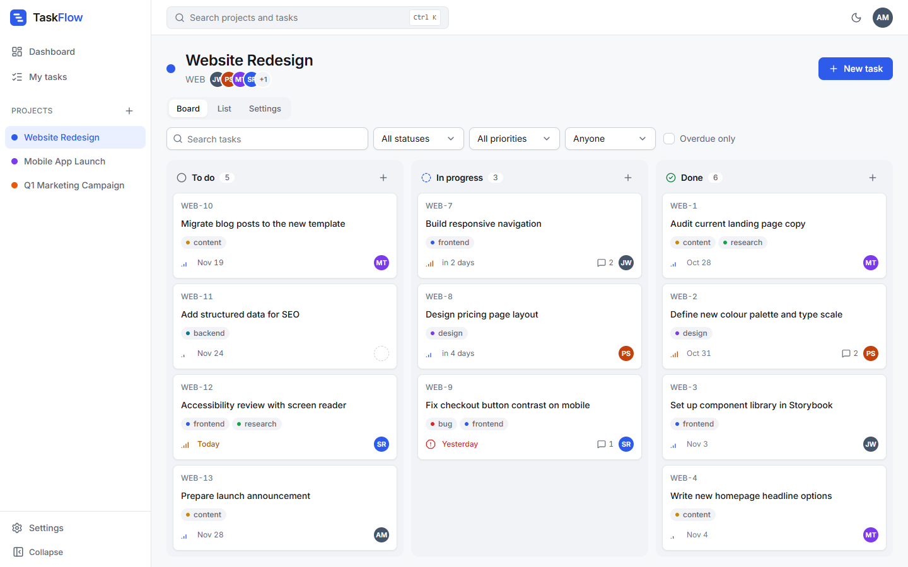
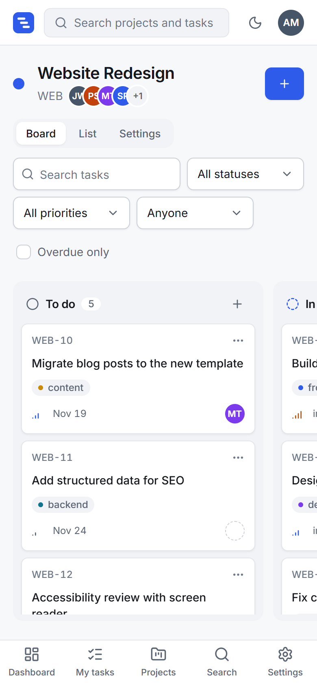
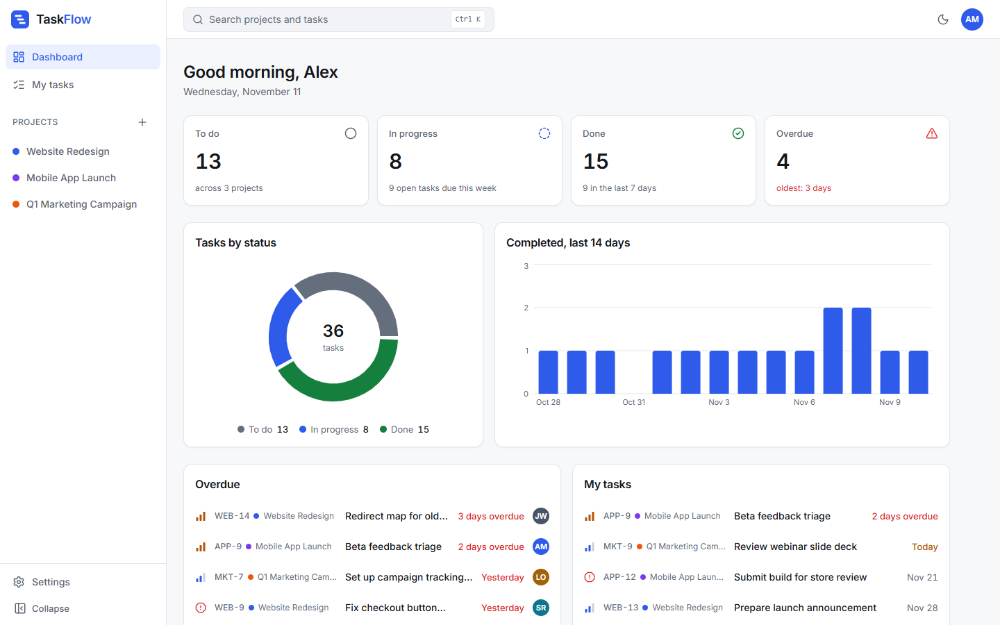
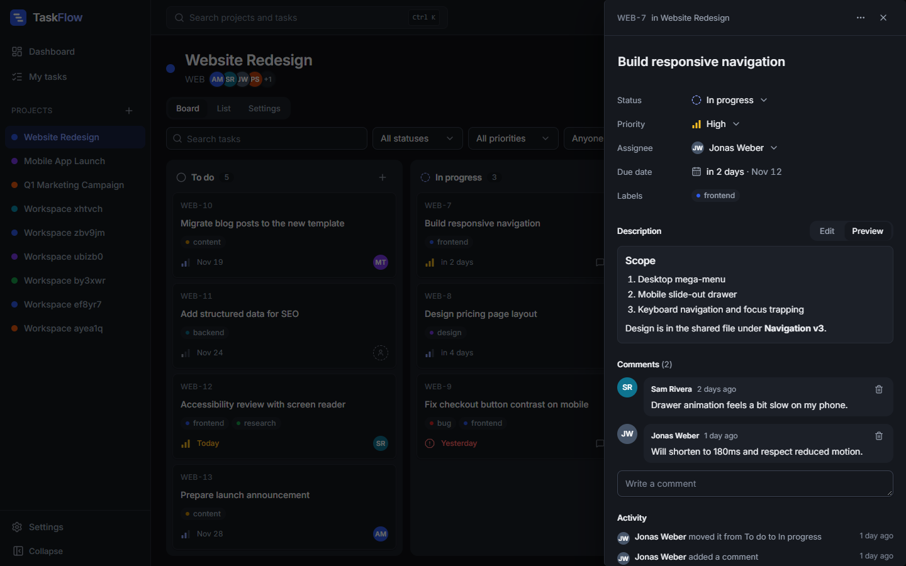
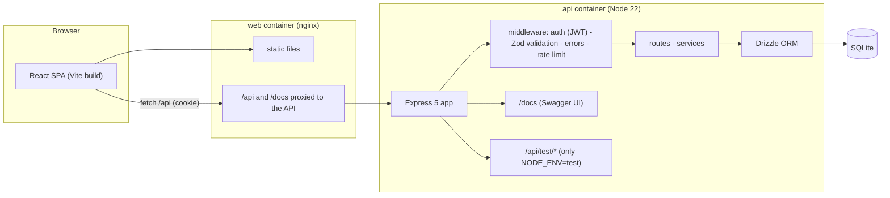

# TaskFlow

A task and project tracker for small teams: a drag-and-drop Kanban board, a filterable list view and a dashboard, with roles, invites, dark mode and a command palette.

> **This is a personal portfolio project** by Mikayel Vasilyan. It is not a real product and has no customers. It is also the system under test for my Playwright and Jenkins framework, [`playwright-jenkins-e2e`](https://github.com/mikayelvasilyan/playwright-jenkins-e2e), which is why it has stable test ids and test-only seeding endpoints.

**Live demo:** coming soon (see [DEPLOY.md](DEPLOY.md); deploying needs the owner's Render account).
**API docs:** `/docs` (Swagger UI) on any running instance.

|                       Desktop board                       |                       Phone board                       |
| :-------------------------------------------------------: | :-----------------------------------------------------: |
|  |  |

|                         Dashboard                          |                            Task panel (dark)                             |
| :--------------------------------------------------------: | :----------------------------------------------------------------------: |
|  |  |

More screens (landing, list, settings, command palette, empty states, every page in light and dark on desktop and phone) are in [`docs/screenshots`](docs/screenshots).

## Features

- **Auth and roles:** sign up, log in, log out. Passwords are hashed with bcrypt. `admin` sees every project and can manage members; `member` sees only their projects.
- **Projects:** create, rename, delete. Invite by email (stored only; nothing is sent). Existing users join immediately, others are added when they sign up.
- **Tasks:** title, Markdown description, status, priority, due date, assignee, labels, comments and an activity log.
- **Kanban board:** drag cards between columns with a mouse, a finger (long press) or the keyboard (Space, arrows, Space). A "Move to" menu is the non-drag alternative. Moves are optimistic and roll back on error.
- **List view:** search, filter by status, priority, assignee, overdue; sort; all state lives in the URL, so views are shareable.
- **Dashboard:** counts per status, overdue and "my tasks", a 14-day completion chart.
- **Polish:** light and dark themes, skeleton loaders, empty states, toasts, a 404 page, `Ctrl/Cmd + K` command palette, keyboard shortcuts (`?` lists them), relative due dates ("tomorrow", "2 days overdue"), and a layout that works on phones (bottom navigation, swipeable board columns, filter sheet).

## Tech stack

| Area      | Choice                                                                                                              |
| --------- | ------------------------------------------------------------------------------------------------------------------- |
| API       | Node 22, TypeScript (strict), Express 5, Zod validation, JWT in an httpOnly cookie (Bearer also accepted)           |
| Database  | SQLite via Drizzle ORM and libSQL (prebuilt binaries, no native compile)                                            |
| API docs  | OpenAPI 3.1 generated from the same Zod schemas, served by Swagger UI                                               |
| Web       | React 19, Vite, TypeScript (strict), Tailwind v4, Radix primitives, dnd-kit, Recharts, TanStack Query, React Router |
| Tests     | Vitest, Supertest, Testing Library, MSW; Playwright (Chrome) for the browser checks                                 |
| Packaging | Docker (API image, nginx web image, single-image deploy), Docker Compose                                            |
| CI        | GitHub Actions: lint, typecheck, tests, build, Docker smoke test, gitleaks                                          |

## Architecture



The browser always talks to `/api` on its own origin (Vite proxy in development, nginx in Docker, Express itself in the single-image deploy), so there are no CORS or cross-site cookie problems. The layering inside the API is `route` (HTTP only), `service` (rules and permissions), `Drizzle`.

## Run it

**With Docker** (one command):

```bash
docker compose up --build
```

Open <http://localhost:8080>. Demo login (shown on the login page): `demo@taskflow.dev` / `Demo123!` (admin) or `member@taskflow.dev` / `Member123!` (member). Data is seeded on first start.

**Without Docker** (Node 22 or newer):

```bash
npm ci
npm run dev        # API on :4000, web on :5173
```

Configuration comes from environment variables; see [`.env.example`](.env.example) (placeholders only). In production the API refuses to start without `JWT_SECRET`.

## API

Interactive docs are at `/docs` and the raw spec at `/docs/openapi.json`. All errors share one shape:

```json
{
  "error": {
    "code": "VALIDATION_ERROR",
    "message": "Invalid request",
    "details": [{ "path": "email", "message": "Enter a valid email" }]
  }
}
```

Codes: `VALIDATION_ERROR` (400), `UNAUTHENTICATED` (401), `FORBIDDEN` (403), `NOT_FOUND` (404), `CONFLICT` (409), `RATE_LIMITED` (429). A test fails if any route is missing from the OpenAPI document.

### Built for test automation

- `GET /api/health`
- `POST /api/test/reset` and `POST /api/test/seed` exist **only when `NODE_ENV=test`**; in every other environment the routes are not mounted and return 404 (covered by tests). `seed` creates an isolated workspace with unique users, so parallel tests do not collide.
- Every interactive element has a stable `data-testid`; the full list is in [docs/TEST_IDS.md](docs/TEST_IDS.md) and is generated from the source.
- `docker-compose.test.yml` is the override the E2E repo uses (test mode, API on `:4000`, throwaway database).

## Tests and results

```bash
npm test               # API and web suites
npm run lint && npm run typecheck && npm run build
BASE_URL=http://localhost:5173 npm run a11y          # axe audit of every page (app must be running)
BASE_URL=http://localhost:5173 npm run screenshots   # every page, light/dark, desktop/phone
```

Real results from my last runs (Windows 11, Node 26 locally; Node 22 in a clean Linux container for the CI steps):

| Check                         | Result                                                                                                                                                                                                                                                                               |
| ----------------------------- | ------------------------------------------------------------------------------------------------------------------------------------------------------------------------------------------------------------------------------------------------------------------------------------ |
| API tests (Vitest, Supertest) | **115 passed** in 12 files                                                                                                                                                                                                                                                           |
| API coverage                  | 96.3% lines, 95.7% statements, 92.3% branches, 89.9% functions (thresholds enforced: 80% lines, functions, statements; 75% branches)                                                                                                                                                 |
| Web tests (Testing Library)   | **27 passed** in 5 files                                                                                                                                                                                                                                                             |
| Lint, typecheck, build        | clean                                                                                                                                                                                                                                                                                |
| Drag-and-drop in real Chrome  | 14 of 14 checks: mouse across and within columns, keyboard, touch long press (a quick swipe still scrolls), reduced motion, "Move to" menu                                                                                                                                           |
| Accessibility (axe-core)      | **62 page states** (every page and open dialog, light and dark, desktop and phone): no serious or critical findings, none at all in the final run. **11 of 11** keyboard checks pass (skip link, visible focus, focus trap and focus return in dialogs, command palette, task panel) |
| Secret scan (gitleaks)        | no leaks in the full git history                                                                                                                                                                                                                                                     |
| Docker                        | compose stack, test override and single image built and smoke-tested locally                                                                                                                                                                                                         |

The GitHub Actions workflow ([`.github/workflows/ci.yml`](.github/workflows/ci.yml)) runs lint and formatting, typecheck, API tests with coverage, web tests, build, a Docker smoke test and gitleaks. **It has not run on GitHub yet** because the repository has not been pushed; I verified every Node step in a clean Linux container, the smoke script locally, and the workflow file with actionlint.

## Accessibility

Contrast is checked against WCAG AA in both themes (the design tokens were adjusted where a pair failed), every input has a label, dialogs trap and restore focus, there is a skip link, focus is always visible, and status and priority never rely on colour alone (icon plus text). The board is fully usable from the keyboard. `npm run a11y` runs axe-core over every page and open dialog in light and dark on desktop and phone sizes and fails on serious or critical findings.

## Project layout

```
api/            Express API, Drizzle schema and migrations, tests
web/            React app, component tests
docs/           screenshots, generated TEST_IDS.md
scripts/        screenshots, accessibility audit, test-id doc generator
Dockerfile      single-image deploy (API serves the web build)
docker-compose.yml, docker-compose.test.yml, render.yaml
PLAN.md         architecture, design system and the task log this build followed
```

## Honest limitations

- **Not deployed yet.** The Render blueprint and a step-by-step [DEPLOY.md](DEPLOY.md) are ready; deploying needs the owner's account. The live demo, once up, resets its data every hour.
- **GitHub Actions has not run yet** (repository not pushed), see above.
- Invites are stored, not emailed. There is no real-time sync between users, no file uploads and no billing; those were out of scope.
- "Today" for overdue logic is the UTC date on both client and server.

## License

MIT, copyright Mikayel Vasilyan. See [LICENSE](LICENSE).
